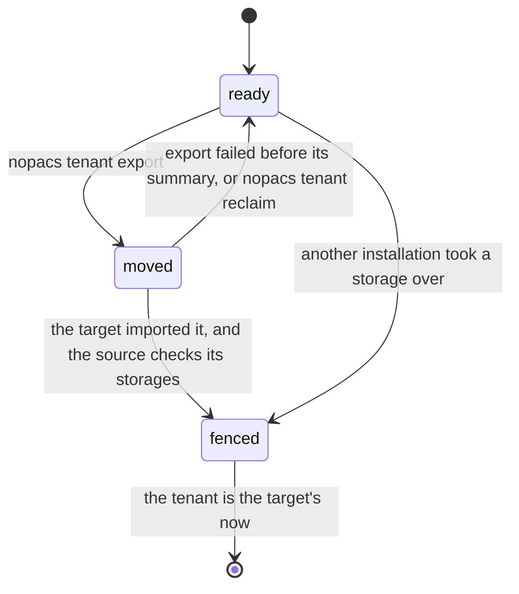

# Backup, restore and moving a tenant

[Documentation index](README.md) · [The command line](command-line.md) · [Running NoPACs](running.md) · [Correcting archived data](correcting.md)

Three jobs share this page: a **backup** of a whole installation, a **restore**
of it onto an empty data directory, and the **move** of one tenant to another
installation. All three are commands that run on the machine itself, as the user
who runs the installation. Backup and restore need the server stopped; a move
starts on the running server and ends with the import on the other machine, with
that machine's server stopped. The rules are in the comments of
[`backup`](../internal/backup/doc.go) and of the contract's
[`backup.proto`](../api/proto/nopacs/v1/backup.proto) and
[`tenant.proto`](../api/proto/nopacs/v1/tenant.proto).

## What a backup holds

A backup holds what the archive cannot make again from its storages:

- the master database: the tenants, the keys (stored hashed, as they always
  are), the grants, the installation's settings and its audit log;
- each tenant's database: its configuration (receivers, storages, senders,
  profiles), its jobs and receptions, its quarantine records, its corrections,
  and its sealed secrets.

It does not hold:

- **the catalog** (subjects, sessions, scans, instances and the totals derived
  from them). A restore rebuilds it from the storages, so it can never be older
  than the bytes it points at;
- **the storages**: the DICOM files and the records beside them are not copied.
  Back them up with the tools of the place they live in (a disk's, a bucket's).
  A restore expects to find them where they were;
- **the bytes in the incoming area** of the server's disk: files a sender was
  told were received but that were not archived yet, and the bytes of held
  quarantined files. Their records are in the backup; the bytes are not.

Each database is read as of one moment, its *recovery point*. Anything changed
after it is not in the backup.

## Make a backup

The server must be stopped. The command takes the data directory's lock, so it
refuses while a server runs on it.

```sh
nopacs-server backup create --data-dir /var/lib/nopacs --out /backups/nopacs-2026-11-22.backup
```

The flags are `--out` (required) and `--master-env`, the name of an environment
variable holding the master database's address when it is not SQLite in the data
directory. The data directory is `--data-dir` or `NOPACS_DATA_DIR`.

- The file is written beside `--out` with mode 0600 and renamed over it only
  once it is whole, so a failed backup leaves nothing.
- A backup is of the whole installation or nothing: a tenant whose database does
  not answer fails it.
- The command prints the file's size and SHA-256, each database's recovery point
  with its count of tables and rows, and the key version.

**Encryption.** The file is encrypted with a key derived from the installation
key file (`key` in the data directory), so it opens only with that file, and the
sealed secrets inside it are useless without that file anyway. Keep a copy of
the key file **apart from** the backup: with the backup alone nothing can be read,
and with the backup but not the key file nothing can be restored.

### Check a backup

```sh
nopacs-server backup verify /backups/nopacs-2026-11-22.backup --key-file /safe/nopacs.key
```

`verify` reads the file whole and checks what a restore checks before it writes
anything: every chunk authenticated with the key file, the layout and every
count, each section's SHA-256 against the footer, the end of the file, and that
each schema version is one this build restores. It writes nothing and may run
while the server runs. Without `--key-file` it uses the key file of the data
directory (`--data-dir` or `NOPACS_DATA_DIR`).

It prints what the backup holds and what a restore of it could not bring back:
per tenant, the files of unfinished receptions and the held quarantined files
whose bytes were in the incoming area. It does not read the storages, so it
cannot say what a restore will find there.

Check a backup after copying it, and now and then by restoring one on a spare
machine.

## Restore

A restore loads a backup into a data directory that is absent, empty, or holds
only the key file. The server must not run: the restore takes the same lock.

```sh
nopacs-server backup restore /backups/nopacs-2026-11-22.backup \
  --data-dir /var/lib/nopacs --key-file /safe/nopacs.key
```

The flags are `--key-file` (default: the data directory's), `--master-env` (the
variable holding the address of an *empty* database for the master, when it is
not SQLite in the data directory), `--scratch-schema` (the Postgres schema a
tenant on Postgres has its catalog rebuilt in; it must exist, and the tenant's
own database must be empty) and `--take-over`.

What it does, in order:

1. **Checks the whole file** before writing anything: every chunk, every
   section's SHA-256, every schema version. A file that fails changes nothing.
2. **Loads each database** at its own schema version and brings it to this
   build's.
3. **Suspends every key** (below).
4. **Reconciles each tenant with its storages**, one tenant at a time:
   - the owner record on each storage is taken one generation further, so no
     other installation still writing the storage goes unnoticed (see
     [Fenced](#fenced));
   - the correction records on the storages, which may be newer than the
     backup, are read, and none is trusted alone. A record with no row in the
     backup becomes a correction left *unresolved* for an admin to decide: a
     delete holds its data hidden until an admin undoes or purges it, and the
     record's word that it was purged or undone is not taken. A record that
     disagrees with the backup's row leaves the row as it is, and is reported.
     A record that does not verify under this key file for this tenant is
     treated as if it were not there, and reported;
   - the catalog is rebuilt from the storages;
   - a new event history begins, which tells every consumer of the feed to start
     again.
5. **Writes the installation's id last.** A restore stopped half way leaves a data
   directory the server refuses to start on, with a marker saying a restore was
   interrupted. Remove the contents of the data directory except the key file
   (and empty the Postgres schemas it filled), then run the restore again.

Then it prints what came back, and, per tenant, what is lost: configuration
changed after the recovery point (the storages show only what corrections did),
the receptions that were unfinished (the sender must send those files again),
the bytes of held quarantined files that were in the incoming area (their records
come back marked *incoming lost*), the events after the recovery point, and the
audit entries after it. The restore's own audit entry is in the master's log.

Start the server afterwards with `nopacs-server serve --data-dir /var/lib/nopacs`.

### Keys come back suspended

A key revoked, or a grant removed, after the backup would otherwise work again.
So **every key is suspended** by the restore: it is refused for remote callers
(the same answer as for a key that is no good), whatever its row said.

Review the keys, then reinstate those that should work, on the machine's local
socket, where commands need no key:

```sh
nopacs key list --data-dir /var/lib/nopacs          # each shows as suspended
nopacs key revoke <id> --data-dir /var/lib/nopacs   # one that should stay ended
nopacs key reinstate <id> <id>... --data-dir /var/lib/nopacs
nopacs key reinstate --all --data-dir /var/lib/nopacs
```

`nopacs key reinstate` (`AccessService.ReinstateKeys`) clears the suspension of
the keys named, at most 1000 at a time, or of every suspended key with `--all`,
which prints only the count. A key named that is not suspended is left as it is
and said so. Each key reinstated has its own entry in the installation's audit
log, with the key's id as its object. Reinstating does not bring back a revoked
or expired key: it stays refused. Only the local operator may reinstate: a key
is answered permission denied whatever its grants, since every key may be
suspended and none may lift a suspension. Review which keys deserve it first:
that is the point of the suspension.

Rotating a key on the local socket (`nopacs key rotate <id>`) is the other way
back: the successor is shown once, holds the same grants, holder, networks and
client certificate, and is not suspended, while the old key stays refused. Use
it for a key whose secret may have leaked while the installation was down.

### When `--take-over` is needed

On each storage a tenant writes there is an *owner record* naming the
installation, the tenant and a generation. The restore refuses a storage whose
record names another installation or tenant, or a later generation than the
backup holds: something took that storage over after the backup, and two
installations must not write one storage. Stop whatever else uses it, then run
the restore again with `--take-over` if the storage is yours to take back. Do not
use it to get past the refusal without knowing why it came.

## Moving a tenant to another installation

A move takes a tenant, with its configuration and its record of corrections,
from one installation (the *source*) to another (the *target*), leaving the
storages where they are. Both installations keep their own key files: they never
meet.



### On the source: export

Run by an installation admin, on any machine that reaches the server:

```sh
nopacs tenant export lab1 --out lab1.export --key-out lab1.key
```

Both files must be new; neither is ever written over one that is there. The
server then:

1. makes the tenant **moved**: its reads are served, every change is refused
   (FAILED_PRECONDITION, reason `TENANT_MOVED`), and its receivers refuse new
   files;
2. **drains** it: the reception pipeline stops (what it holds is archived or
   left in the incoming area with its place kept) and the background work of
   corrections finishes the step it is at. The drain waits up to 90 seconds;
3. takes the **owner record** of each storage one generation further;
4. streams the tenant's database without its catalog, encrypted under a
   **transfer key** made at random for this export. Every sealed value in it is
   opened with this installation's key file and sealed again under that key;
5. sends the summary with the transfer key last. The command writes the key,
   once, to `--key-out` with mode 0600, then puts the export at `--out`.

An export is refused while a rebuild of the tenant runs, while a correction of
it is prepared, or while another export or backup runs on this server (one runs
at a time).

If the command fails **before the summary**, no key reached anyone, and the
server gives the tenant back (ready again), with an audit entry saying so. Once
the export is whole the tenant **stays moved**, whether or not the command saw the
end of it. If the key file cannot be written after that, the tenant is moved and
its key is lost: reclaim it and export again.

Stop the tenant's senders' work first if it must not be cut: a job's unit in
flight stops, with its place kept.

**Carry the files safely and apart.** The export is useless without the transfer
key and the key is useless without the export, so send them by different routes
and delete both from the source machine and from any place in between once the
import has succeeded. Anyone who holds both can read the tenant's secrets.

### On the target: import

The target's server must be stopped. Before it, make the target's key and the
storages ready:

- the target must **list the tenant's storages**: a directory storage's root,
  by the same root name, in `storage.directory-roots`, or an S3 storage's
  endpoint. The files stay where they are;
- keys and grants stay with the source. Give the target's own keys grants on the
  tenant afterwards.

```sh
nopacs-server tenant import lab1.export --transfer-key lab1.key --data-dir /var/lib/nopacs
```

The flags are `--transfer-key` (required), `--master-env`, `--db-env` (the
variable holding the address of an *empty* Postgres schema to load the tenant
into; without it the tenant is SQLite in the data directory), `--scratch-schema`
(for a Postgres tenant's catalog) and `--take-over`.

It reads and checks the whole file under the transfer key first; nothing is
written if that fails. Then:

- the tenant's database is loaded, and every sealed value is opened with the
  transfer key and **sealed again under the target's key file**, so labels,
  remapped UIDs and date shifts stay what they were. The tenant keeps its name
  and its id;
- each storage's owner record is written naming the target, **one generation
  past the export's**. The source, if started again against the same storages,
  fences the tenant instead of writing beside the target;
- every correction record is **written again under the target's key**;
- the catalog is rebuilt from the storages and a new event history begins;
- the tenant is registered last, with an audit entry, so a tenant the server
  opens was taken over whole.

A tenant of the same name or id on the target refuses the import. A storage whose
owner record names an installation other than the source, or a later generation
than the export's, is refused unless `--take-over` is given. An import stopped half
way leaves the tenant's database, named in the message, and no tenant: remove that
database and run the import again.

Then start the target's server and give its keys grants on the tenant.

### Take a tenant back: reclaim

If no import followed, the source takes the tenant back:

```sh
nopacs tenant reclaim lab1 --data-dir /var/lib/nopacs
```

Only the **local operator** may run it, on the server's own socket: a key is
refused whatever its grants, because whoever runs the host knows whether the
import went ahead. It is refused while an export of the tenant is running. It
works only while the owner record on each storage still names this installation
and the generation the tenant holds; once another installation has imported, it
names that one and the tenant is not taken back.

Reclaim takes each owner record **one generation further** before the tenant
writes again. So the earlier export can no longer be imported: its generation is
older than the storages' now, and an import of it is refused unless `--take-over`
is given. Export again if the move is still wanted. A tenant already ready is
answered as it stands.

### Fenced

A tenant is *fenced* when the owner record on one of its storages names another
installation, another tenant, a later generation than the tenant's database
holds, or names this installation but does not verify under its key file. That
means another installation has taken the storage over (an import or a restore),
or the record is not one this installation wrote. A fenced tenant is read only,
like a moved one: reads are served, every change is refused (FAILED_PRECONDITION,
reason `TENANT_FENCED`), and no other tenant is affected.

The server checks the owner records when a tenant starts, every 30 seconds, and
before each purge, relabel and replace step. A fence is kept in the master
database, so a restart does not lift it, and the server never lifts it itself.

An operator sees it in `nopacs tenant show NAME` and `nopacs tenant list`: the
state is `fenced` and the reason names the storage and why. What to do:

- after a move you made, nothing: the tenant is the target's now. Remove it here
  when you are sure (`nopacs tenant remove NAME --yes` unregisters it; its
  database and files stay where they are);
- if you did not expect it, find out which installation wrote the owner record
  before anything else writes that storage. `nopacs tenant reclaim` refuses a
  tenant whose record names another installation, so it cannot be used to
  override another installation's claim.

## What stays weak

- **The check is between writes, not a lock.** Two servers started against the
  same storages within one 30-second check of each other could both write until
  the next check.
- **The audit chain is not verified across a move.** The tenant's audit log and
  its checkpoints travel inside its database, but the target does not check them
  against the source's audit public key; the import's own entry is in the
  target's installation log.
- **Keys and grants do not travel.** The target needs its own keys and grants for
  the tenant.
- **Job units in flight** during a drain stop with their place kept; they are not
  finished. A sender's work that must not be cut should be stopped first.
- **Incoming bytes are not carried.** After a restore or a move, files a sender
  was told were received but not yet archived are gone, and the held quarantined
  files whose bytes were in the incoming area come back as records marked
  *incoming lost*. Senders must send them again.
- **The drain can fail.** If the tenant's pipeline does not stop within 90
  seconds the export fails and the tenant is given back; try again when it is
  quieter.
- **There is no backup call on the API yet.** `CreateBackup` is in the contract
  and answers UNIMPLEMENTED; a backup is made on the machine, with the server
  stopped. Restore and import are local commands by design.
- **Storages are not part of a backup.** What a backup cannot bring back, the
  storages' own backups must.
