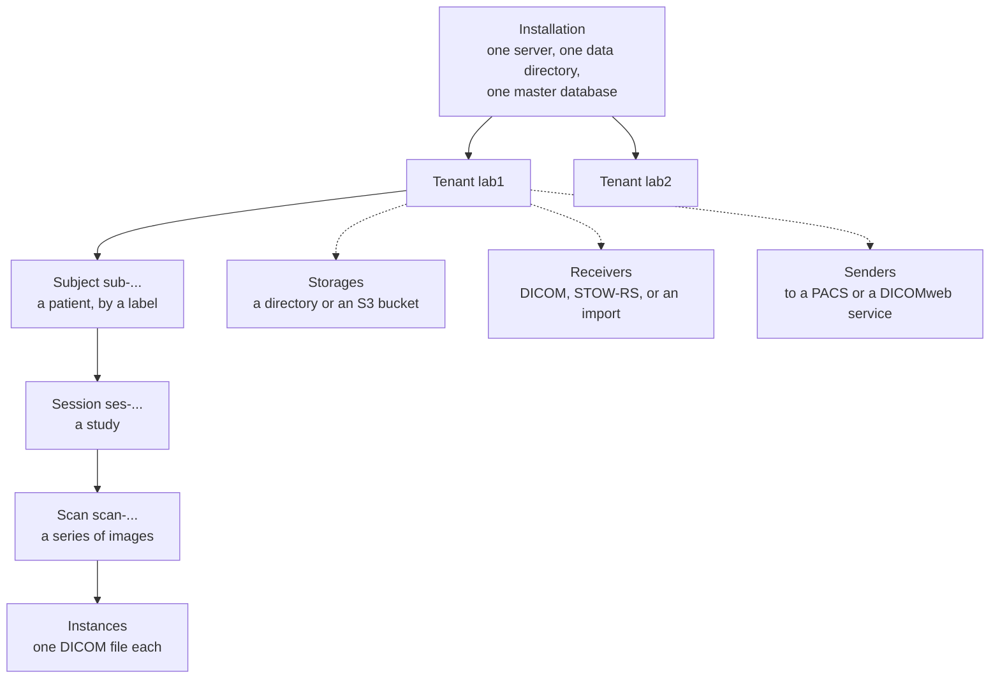

# What an archive is made of

[Documentation index](../README.md) · [The lifecycle of a file](lifecycle.md) · [The security model](security.md) · [A first archive](../start/first-archive.md)

The words NoPACs uses, and how the things they name fit together. They are used
the same way on every page, in the commands and in the API.

## Installation

One running server and everything it keeps: its **data directory** (the key file,
the master database, the incoming area, and a database for each tenant that is in
SQLite), and the **master database**, which holds the tenants, the keys, the grants,
the installation's settings and its audit log. You make one with
`nopacs-server init` and run it with `nopacs-server serve`. One server runs
on a data directory; a second is refused.

The *installation key file* seals every secret the installation keeps (a tenant
database's password, a storage's credential), and the audit log's signatures are
derived from it. Losing it loses them all.

## Tenant

An independent archive inside an installation: its own database, its own storages,
receivers and senders, its own profiles, quarantine and audit log, and its own
settings where a setting may differ. What one tenant does never reads or changes
another's, and a key is granted a role on each tenant separately. Use a tenant for
each group of data that must be kept apart: a study, a lab, a site.

There is no level between an installation and a tenant, and none between a tenant
and a subject: no "project".

The installation decides where a tenant's data and receivers may be (which
directories, which S3 endpoints, which ports); the tenant then uses what it was
allotted. See [the settings](../reference/settings.md).

## Subject, session and scan

The archive names what it holds in three levels, which follow DICOM's
patient, study and series:

| Archive | DICOM | Label looks like |
|---|---|---|
| **Subject** | a patient | `sub-u7ltdkd4c3hufknf` |
| **Session** | a study of that patient | `ses-t3n2ga37btqrofyp` |
| **Scan** | a series of that study | `scan-btwc2xplkk5jrokz` |

Below a scan are its *instances*: one DICOM file each, named by its SOP Instance
UID.

The labels are made by the receiver's **naming rule** when a study arrives. The
default rule uses a keyed hash of the identifiers, so a label carries nothing the
sender wrote and the same patient gets the same label whenever it arrives. A rule
can instead build a label from a value in the file, or from a path (for an import);
a rule that would put a patient's identifier into a label unhashed is refused on a
receiver that de-identifies. A label can be changed later with
`nopacs correction relabel` ([correcting](../use/correcting.md)).

## Storage, receiver, sender

- A **storage** is a place bytes live: a directory (a local disk or a mount) or an S3
  bucket. Each scan is kept whole in one storage, with a manifest of every file's
  SHA-256, and what is read back is checked against it.
- A **receiver** accepts data into a tenant: a DICOM listener (DIMSE) on a port, a
  STOW-RS endpoint for callers that hold a listed key, or an *import* of a
  directory the server can read. It admits only the callers it lists. See
  [receiving](../use/receiving.md) and [importing](../use/importing.md).
- A **sender** sends archived data from a tenant to one named destination, a PACS
  or a DICOMweb service. See [sending](../use/sending.md).

## Key and grant

A **key** is a secret an API caller presents, with an id, an expiry and the name of
the person or system that holds it. A **grant** gives a key a **role** on one tenant
or on the installation. A key with no grant on a tenant is refused there. See
[the security model](security.md).

## What is not here

NoPACs does not keep a viewer, a worklist or a report. It stores, de-identifies,
catalogs, serves and sends. Of replication to a second storage, only `replica backfill`,
recall and the verified sample before a switch are not served yet
([replicas](../operate/replicas.md)).
