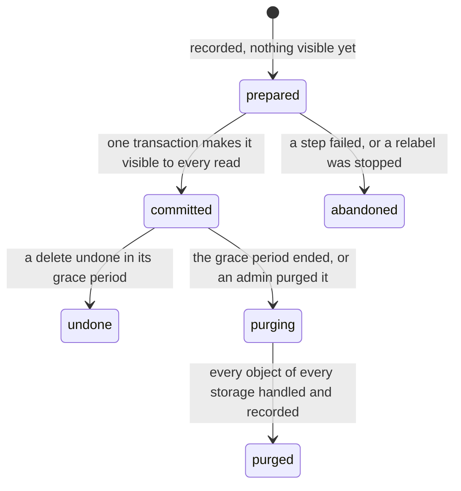

# Correcting archived data

[Documentation index](README.md) · [The command line](command-line.md) · [Settings](settings.md)

A *correction* is a change to archived data made on purpose, with the reason a
person gave, and kept as a record for as long as the tenant is: a **delete** of a
subject, a session, a scan or one instance; a **relabel** of a subject, a
session or a scan; a **replace** of an archived instance by the corrected file a
sender sent again. Corrections are made with `nopacs correction` or
`CorrectionService`; the rules are in the contract's comments on
[`correction.proto`](../api/proto/nopacs/v1/correction.proto) and in
[correct](../internal/correct/doc.go).

Every reason is 1 to 1024 bytes in your own words ("consent withdrawn", "wrong
subject id at the scanner"), never a value read from a file: the correction, its
audit entry and its record on the storage keep it.

| What | Role on the tenant |
|---|---|
| delete, relabel, replace, undo, purge, allow | admin |
| list and show corrections | operator |

## The states of a correction



A correction is recorded in the tenant's database before anything is written to a
storage, and a record of it (`meta/.corrections/<id>.json`) is put on each
storage it touches before it is made visible, so a rebuild or a restore of the
tenant finds it even without the database. A step that fails before the change
is visible abandons it: what it wrote is removed, and nothing changed for any
reader.

## Delete

```
nopacs correction delete lab1 sub-3f9a --reason "consent withdrawn" --preview
nopacs correction delete lab1 sub-3f9a --reason "consent withdrawn"
```

1. **The preview.** The command first asks the server what the delete would
   remove and shows it: the subjects, sessions, scans, instances and bytes; the
   storages that hold it and what each will do with a removed object; the
   senders it was sent to; the jobs that would meet it; the quarantined files
   and the receptions its purge clears; the subject labels arrivals stay held
   under after the purge; and when its bytes would be purged.
2. **The confirmation.** Without `--yes` it asks for the target to be typed
   again; with no terminal it deletes nothing and exits 2.
3. **The delete.** It carries the preview's token, a value only this server
   makes, valid for an hour. When anything the preview showed has changed
   since (data arrived under the target, a job was made), the delete is refused
   (exit 5) and the command is run again, so a delete acts on what a person
   saw. The same token sent again with the same target answers the delete it
   made, so a client that lost the answer can send the request again; with
   another target it is refused (exit 5). The server remembers a used token
   only while it runs, and only its last 1024 or so: after a restart, or once
   forgotten, the repeat is answered not found (exit 4), since the target is
   hidden; `nopacs correction list` then shows the delete.

The data is hidden from every read at once: the catalog, DICOMweb, reads and
downloads answer as if it did not exist, and jobs that meet it count it as
deleted and go on. An instance delete hides that instance alone; at its purge a
new manifest of its scan without it is written.

## The grace period, undo and the purge

The bytes stay on the storage, unserved, for the tenant's `delete.grace`
(`7d` by default, `0d` to `90d`; a tenant's admin may set the tenant's own).
The purge time is fixed when the delete is made: a later change of the setting
moves no purge already set, and no date read from a file is used.

- **Undo.** `nopacs correction undo lab1 <id> --reason TEXT` shows the data
  again, as it was, until the purge starts.
- **The purge.** The server runs a pass every minute that purges each
  correction whose grace period has ended. `nopacs correction purge lab1 <id>`
  purges at once (`--wait` waits until it ends). Each object is read for its
  size and SHA-256, compared with what was archived, removed through its
  storage, and recorded with what the storage said it did; the manifests and
  metadata last; then the catalog's rows. Nothing is undone once a purge has
  started. A purge stopped midway (a restart, a storage that does not answer)
  goes on by itself.
- **The clock.** A purge whose time came by itself waits while the server's
  clock reads earlier than a time it already recorded, or more than two days
  past the last time it trusted: a clock set back, or one that jumped forward,
  never ends a grace period early. An admin's purge trusts the clock it runs at.

### What "purged" means

`nopacs correction show` says, per storage, what the storage did with the
objects it purged, never more strongly than the storage said it:

| Disposition | What it means |
|---|---|
| removed | the bytes are gone from this storage: a file removed from a directory, an object deleted from an unversioned bucket, or every version deleted by its version id |
| hidden | the key answers not found, but older versions remain (a versioned bucket the server was not allowed to delete versions in) |
| retained | the storage refused, under its object lock, until the time it states |
| unknown | the server could not learn what the storage did |

A withdrawal is complete on a storage only where every object is removed.

### What is kept

- **Objects a live row still uses**, and a manifest or metadata a reception
  rewrote since the delete, are left where they are and counted as kept, never
  as removed. `objects_owned` is every object the correction owns;
  `objects_removed` and `objects_kept` together reach it when the purge is done.
- **What names the deleted data**: the subject's label, each study's, series'
  and instance's UID. A file that matches one later is quarantined as
  `was_deleted`, with none of its bytes kept, rather than archived: a withdrawal
  holds against the next re-send.
- **The correction and its records**, for as long as the tenant is, so a
  restore from an older backup applies the delete again.

### Letting data arrive again

When a withdrawn consent is given again:

```
nopacs correction show lab1 <id>          # lists the values the delete holds
nopacs correction allow lab1 <id> --subject sub-3f9a --reason "consent given again"
nopacs correction allow lab1 <id> --study 2.25.1234 --reason "consent given again"
```

One value at a time, once the delete is purged, so a withdrawal is never
lifted wider than meant. A file matches a delete while any value it holds
matches the file, so a whole subject arrives again once each of its values is
allowed. Files quarantined as `was_deleted` before kept no bytes: the sender
sends them again.

## Relabel

```
nopacs correction relabel lab1 sub-3f9a --to sub-0042 --reason "wrong subject id at the scanner" --wait
```

Labels are part of every stored object's key, so a relabel copies each object
to its key under the new label, reads it back and compares its SHA-256, in the
background; readers see the old label until the whole target switches at once.
A lookup by the old label then answers not found. The old objects stay,
unserved, until the correction's purge after the grace period. A relabel still
copying is stopped with `correction undo`, which removes its copies. A relabel
of the same target to the same label asked again answers the same correction.

While a delete or a relabel has not ended, the labels and UIDs it holds are not
used by an arrival: a file that would land on them is quarantined as a label
conflict naming the correction, and is released once the correction has ended.

## Replace

```
nopacs quarantine list lab1 --reason different-file
nopacs correction replace lab1 q_41Ab --reason "corrected file sent again by the site"
```

A file quarantined as a **different file** (a file under a SOP Instance UID the
tenant holds, with other bytes: the corrected file a sender sent again) or as
**repairing a damaged instance** replaces the archived instance. It is first
de-identified as its receiver's profile version says, as a release would, and is
never archived as received when that receiver de-identifies. The new bytes go
to the instance's next revision (`<UID>.r2.dcm`); the old revision stays,
unserved, until the purge. `ResolveInstances` answers, for an (instance,
revision) pair a platform kept, whether it is current, superseded, deleted or
unknown. A replace is not undone: the way back is another replace from the old
file.

## What the archive cannot reach

- Copies already sent to a peer by a job or a receiver's forward are the
  peer's: the preview lists each sender and how many instances it was sent, so
  a person can ask the peer to delete them.
- A file a client downloaded is the client's. An instance deleted answers not
  found; a replaced instance has a new SHA-256, so a download resumed against
  the old one starts again whole.
- Events already in the live feed keep the labels they carried until
  `events.retention`.
