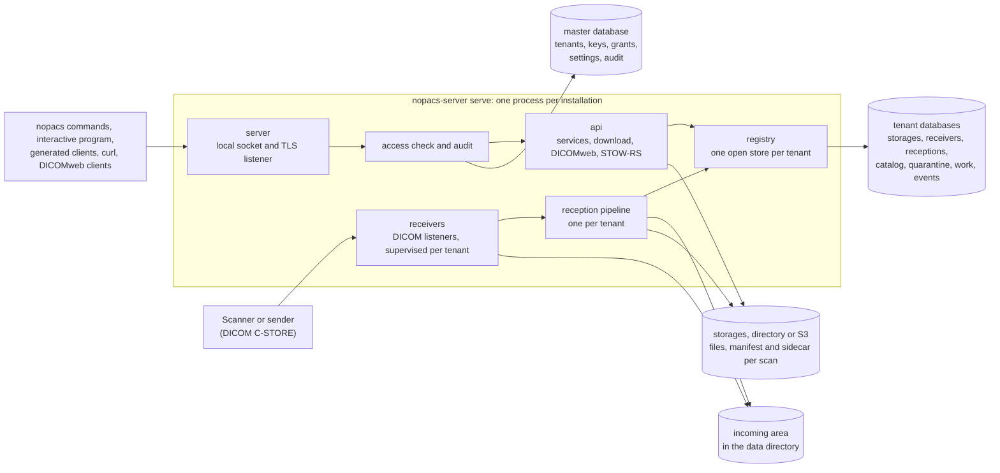
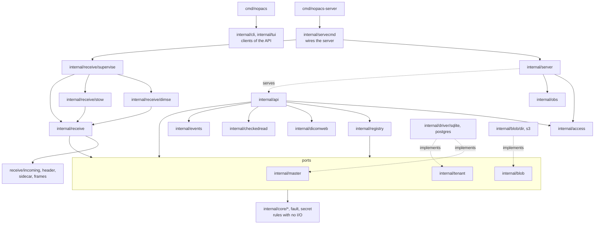
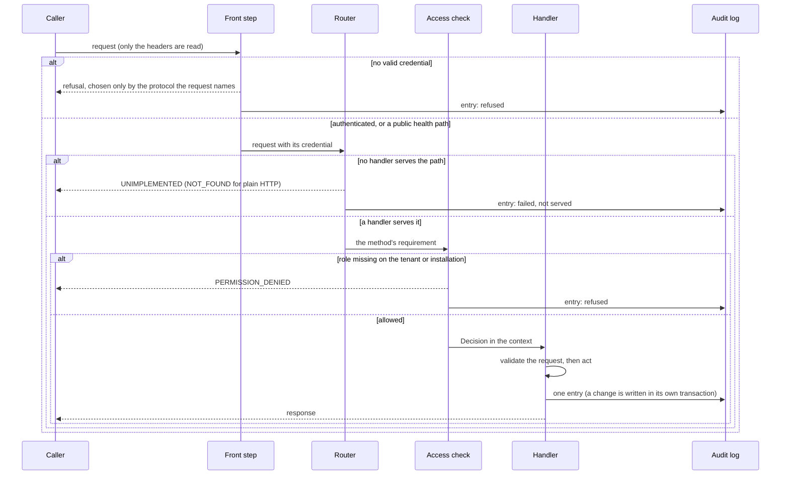

# Architecture

[Documentation index](../README.md) · [A reception, end to end](../use/receiving.md) · [Reading the archive](../use/reading.md) · [The databases](database.md) · [Testing](testing.md)

How NoPACs' parts meet. Each package's own documentation is its `doc.go` (open
it, or run `go doc ./internal/<package>`); this page holds what no single package
can say: the parts and how they connect, the path of a request, where state
lives, and the rules that hold the layout together.

## The shape

NoPACs is two binaries from one module, built and released together with one
version:

- **`nopacs-server`**, built from [cmd/nopacs-server](../../cmd/nopacs-server/doc.go): the server
  (`nopacs-server serve`: the API over TLS and a local socket, DICOM receivers,
  and the reception pipeline of every tenant) and the commands that must touch
  the data directory with no server running (`init`, `backup`, `tenant import`);
- **`nopacs`**, built from [cmd/nopacs](../../cmd/nopacs/doc.go): a command line
  (`nopacs tenant create ...`) and an interactive program (`nopacs` with no
  arguments), both clients of that API and nothing else. It links no database or
  storage driver; lint and a test of `cmd/nopacs` keep them out.

Underneath, the code is ports and adapters. A *port* states what a kind of thing
holds or does, as Go interfaces with their rules, and has a *contract suite* every
implementation passes. An *adapter* (a driver) implements a port for one
technology. Everything else depends on ports, never on a driver.

## An installation

An installation is one server process with its data directory. Callers reach it
through the API; senders reach its receivers; everything it keeps is in one of
four places.

## How the packages depend on each other

A line reads "uses". The ports (`master`, `tenant`, `blob`) are what the rest
depends on; a driver is reached only by the one package that opens it.

Each part is documented where it lives:

- **Rules with no I/O**, which import nothing of NoPACs' outside the core:
  [label](../../internal/core/label/doc.go), [naming](../../internal/core/naming/doc.go),
  [layout](../../internal/core/layout/doc.go), [manifest](../../internal/core/manifest/doc.go),
  [reception](../../internal/core/reception/doc.go), [settings](../../internal/core/settings/doc.go),
  [uid](../../internal/core/uid/doc.go), [ascii](../../internal/core/ascii/doc.go),
  [pathname](../../internal/core/pathname/doc.go); and [fault](../../internal/fault/doc.go),
  the error kinds every layer answers with.
- **Ports and their contract suites**: [master](../../internal/master/doc.go) (the
  installation's database, suite [mastertest](../../internal/master/mastertest/doc.go)),
  [tenant](../../internal/tenant/doc.go) (one tenant's database, suite
  [tenanttest](../../internal/tenant/tenanttest/doc.go)), [blob](../../internal/blob/doc.go)
  (a storage, suite [blobtest](../../internal/blob/blobtest/doc.go)).
- **Drivers**: [driver](../../internal/driver/doc.go) opens a database by its address;
  [sqlite](../../internal/driver/sqlite/doc.go), [postgres](../../internal/driver/postgres/doc.go)
  and what they share, [sqlkit](../../internal/driver/sqlkit/doc.go); storages
  [dir](../../internal/blob/dir/doc.go) and [s3](../../internal/blob/s3/doc.go).
- **The server**: [server](../../internal/server/doc.go) (listeners, limits, the
  request path), [access](../../internal/access/doc.go) (keys, grants, the check, the
  audit), [api](../../internal/api/doc.go) with [codes](../../internal/api/codes/doc.go),
  [dicomweb](../../internal/dicomweb/doc.go) (the protocol without the archive),
  [checkedread](../../internal/checkedread/doc.go) (bytes checked as they are read),
  [registry](../../internal/registry/doc.go), [events](../../internal/events/doc.go),
  [place](../../internal/place/doc.go) (where data may be),
  [settingvalue](../../internal/settingvalue/doc.go), [secret](../../internal/secret/doc.go),
  [obs](../../internal/obs/doc.go) and [redact](../../internal/obs/redact/doc.go).
- **Reception**: [receive](../../internal/receive/doc.go) (the pipeline),
  [dimse](../../internal/receive/dimse/doc.go), [stow](../../internal/receive/stow/doc.go),
  [supervise](../../internal/receive/supervise/doc.go),
  [incoming](../../internal/receive/incoming/doc.go),
  [header](../../internal/receive/header/doc.go), [sidecar](../../internal/receive/sidecar/doc.go),
  [frames](../../internal/receive/frames/doc.go).
- **Clients**: [cli](../../internal/cli/doc.go), [client](../../internal/cli/client/doc.go),
  [output](../../internal/cli/output/doc.go), [servecmd](../../internal/servecmd/doc.go),
  the [interactive program](../../internal/tui/doc.go), and the generated clients in
  `clients/python` and `clients/typescript`.
- **Tests only**: [testkit](../../internal/testkit/doc.go),
  [fakeserver](../../internal/testkit/fakeserver/doc.go),
  [servertest](../../internal/testkit/servertest/doc.go). Nothing the binary runs imports
  them: lint enforces it for `testkit`; for the other two, `go list -deps
  ./cmd/nopacs-server` shows it.

[internal/blob/readat](../../internal/blob/readat/doc.go) reads a stored object at offsets
(`io.ReaderAt`) through the port's ranged reads, so go-dicom can read a header or
walk the items of encapsulated pixel data without fetching the whole object.

## The path of a request

Every request to the API takes the same steps, whichever protocol it speaks. The
steps are in [server](../../internal/server/doc.go) and the check in
[access](../../internal/access/doc.go); this is how they fit together.

A caller with no valid key learns nothing from the answer: not which methods
exist, not whether a tenant does. The order of checks is the contract's: the key
(`UNAUTHENTICATED`), the role (`PERMISSION_DENIED`), then the request itself
(`INVALID_ARGUMENT`). A handler that changes something has the key checked
again first, so a key that lapsed after the check makes no change.

## Where state lives

The tables of both kinds of database are drawn in [the databases](database.md).

- **The master database** (SQLite file or Postgres): tenants, keys (hashed),
  grants, installation settings, the installation's audit log.
- **Each tenant's database** (its own SQLite file or Postgres schema):
  storages, receivers, receptions, received files, the catalog, quarantine, the
  work queue, events, the tenant's audit log.
- **The data directory**: the key file, the SQLite files, the local socket, the
  incoming area, a lock that keeps a second server away.
- **Storages**: the archived objects, a manifest and a sidecar per scan.

A restart loses nothing held only in memory: a reception in progress, a unit of
work and an event not yet delivered are all rows.

## The rules, and what enforces each

| Rule | Enforced by |
|---|---|
| One static binary, pure Go | `CGO_ENABLED=0` in every build; `make check-static`; lint forbids `unsafe` and `plugin` in the core |
| The core does no I/O and imports nothing of NoPACs' | lint rule `core` (`.golangci.yml`) |
| A port knows no database or file system and never imports a driver | lint rules `master`, `tenant`, `blob` |
| A database is reached only through its port; no code outside a driver knows which | lint rules `master`, `tenant`, `registry`, `receive`, `api-driver`; only `driver/postgres` imports pgx (`postgres-library`) |
| A storage is reached only through `blob.Store` | lint rules `blob`, `receive` |
| Every driver passes its port's contract suite | each driver's tests run the suite; `make test-postgres` and `make test-s3` run it against Postgres and both S3 servers |
| Only `receive/dimse` speaks DICOM on the network | lint rule `dicom-network` |
| Test helpers never reach the binary | lint rule `testkit` |
| One error kind per kind the contract names, mapped in one place | `internal/api/codes` and its tests |
| A secret never appears in a log, an error or an answer | `internal/secret` (unprintable type), `obs/redact`, the proof's searches of logs, audit and databases (`make prove`) |
| Every access and change is audited | `internal/access`; the proof reconciles every request with the audit log |
| A file acknowledged to a sender is never lost or archived twice | the incoming area's sync before acknowledgement; the pipeline's crash matrix test; `make prove-reception`'s kills at each step |
| State lives in the database, not memory | recovery at start (the pipeline's `Recover`, the work queue's repair and reclaim); restart tests |
| Reception does not get slower unseen | `make bench-gate`, run before a push that changes the reception path |
| Nothing in the repository refers to notes outside it | `make check-comments` |

The gates are in [Gates and outside checks](gates.md).

## Next

- [A reception, end to end](../use/receiving.md): what happens from a sender's first
  file to a verified scan.
- [Reading the archive](../use/reading.md): the catalog, metadata, data and DICOMweb,
  and what a read checks.
- Extending: [a database driver](guides/database-driver.md),
  [a storage driver](guides/storage-driver.md), [an API method](guides/api-method.md),
  [a migration](guides/migration.md), [an event type](guides/event-type.md).
