# The databases

[Documentation index](../README.md) · [Architecture](architecture.md) · [Testing](testing.md) · [Gates and outside checks](gates.md) · [Changing a schema](guides/migration.md)

The tables of NoPACs' two kinds of database, drawn. The schema itself is the
baseline file of each database and driver (`0001_baseline.sql` in
`internal/driver/sqlite/migrations/<master|tenant>/` and
`internal/driver/postgres/migrations/<master|tenant>/`); each table has a comment there
that says what it holds and why its constraints exist. These pages show how the tables
relate, which the file's order does not.

## Two kinds of database

An installation keeps one **master database** and one database for each tenant
([where state lives](architecture.md#where-state-lives)).

- The master database holds the tenants, the keys (as hashes), the grants, the
  installation's settings and its audit log
  ([what an installation is](../concepts/archive.md#installation)).
- A tenant database holds everything else about one tenant: its storages, receivers
  and senders, its receptions, the catalog, the quarantine, the work queue and the
  events, its profiles, and its own audit log
  ([what a tenant is](../concepts/archive.md#tenant)).

They are apart because a tenant is an independent archive: what one tenant does never
reads or changes another's, and its database can be copied or handed over whole. For
that, no tenant table holds who may enter the tenant: access lives only in the master
(the tenant schema's own header says so). Each kind can be SQLite or Postgres, chosen
when the database is opened ([choosing a database](../operate/database.md)); the two
drivers have the same tables, with the differences listed [at the end](#where-sqlite-and-postgres-differ).

In the diagrams, a column type is only a hint (`int` is an integer or a `bigint`, `text`
is text). A solid line is a foreign key the database enforces. A dotted line is a column
that names another table's key, with no foreign key behind it: the change that writes it
checks it, inside its transaction. A table drawn with no columns is only there to show
a link from another area. A table's key columns come first; the other columns shown are
the few that explain the table, not all of them.

## The master database

Seven tables. The only foreign keys in either kind of database are the two of `grants`:
a grant refers to a key, and, for a grant on one tenant, to that tenant. `audit` names a
key and a tenant by value with no foreign key, so an entry outlives both.

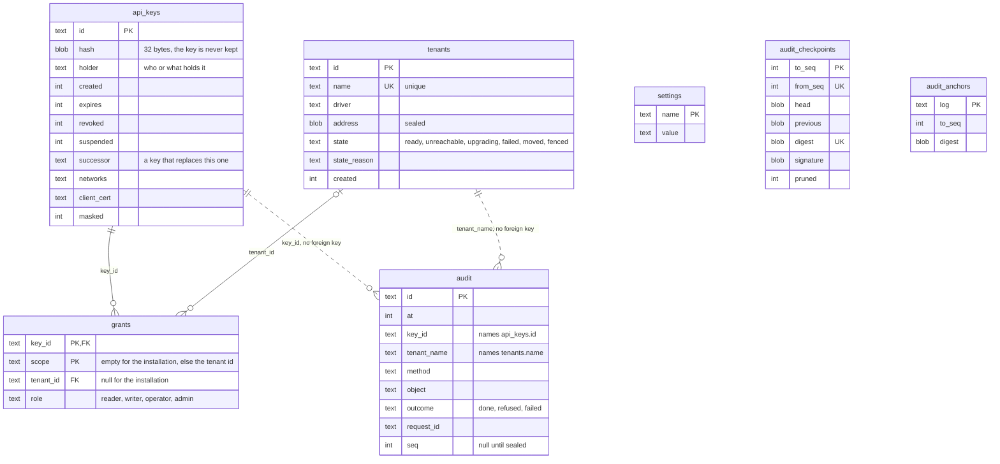

A grant's primary key is `(key_id, scope)`: one role per key and scope, so setting a grant
again replaces the role. `scope` is empty for the installation and the tenant's id
otherwise, and a check keeps `tenant_id` null exactly when `scope` is empty, so the foreign
key can hold for the installation too. `audit.seq` is the entry's place in the log's hash
chain; it is null until a pass seals the entry, and a unique index keeps each place once.
`audit_checkpoints` holds the signed checkpoints of that chain, kept after retention removes
the entries they cover (`pruned`), and `audit_anchors` holds the latest checkpoint of
another log this one keeps.

## A tenant database

A tenant database has 110 tables across the two drivers (109 in each; see
[the differences](#where-sqlite-and-postgres-differ)). **No tenant table refers to another
by a foreign key**: a reception and a quarantine record keep the name of a receiver that
was removed, a job keeps the name of a sender that was removed, and every other reference
is checked by the change that makes it, inside its transaction. So every line in the
diagrams below is dotted. The migration runner also keeps a `schema_migrations` table in
each database; no baseline file creates it, so it is not drawn.

The tenant's tables are drawn in fourteen areas. Every table is in exactly one.

| Area | Tables |
|---|---|
| [Identity, settings and audit](#identity-settings-and-audit) | 6 |
| [Storages, receivers, senders and routing](#storages-receivers-senders-and-routing) | 8 |
| [Receptions and the quarantine](#receptions-and-the-quarantine) | 7 |
| [The catalog](#the-catalog) | 8 |
| [Work and events](#work-and-events) | 5 |
| [De-identification](#de-identification) | 8 |
| [Send jobs](#send-jobs) | 6 |
| [Imports and transfers](#imports-and-transfers) | 8 |
| [Scrub and rebuild](#scrub-and-rebuild) | 5 |
| [Replicas and repair](#replicas-and-repair) | 10 |
| [Corrections](#corrections) | 13 |
| [Rows a delete hides](#rows-a-delete-hides) | 6 |
| [Retention, holds and batch deletes](#retention-holds-and-batch-deletes) | 9 |
| [Search](#search) | 11 |

### Identity, settings and audit

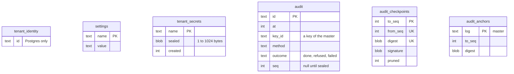

A setting here overrides the installation's setting of the same name; a setting absent
here takes the installation's. `tenant_secrets` holds sealed values (a storage's credential,
for one), never plain ones. The audit tables are the master's, with the same columns, so
one entry type and one listing serve both logs; an entry names keys that live in the master,
with no foreign key. `audit.seq` is null until the entry is sealed and never changes once
given, and a unique index keeps each place once; `audit_checkpoints.from_seq` is unique
too, so two seals racing for the same place cannot both be kept. `tenant_identity` exists
only on Postgres: it holds at most one row, the tenant's id, which the driver compares each
time it opens the schema so two tenants cannot share one.

### Storages, receivers, senders and routing

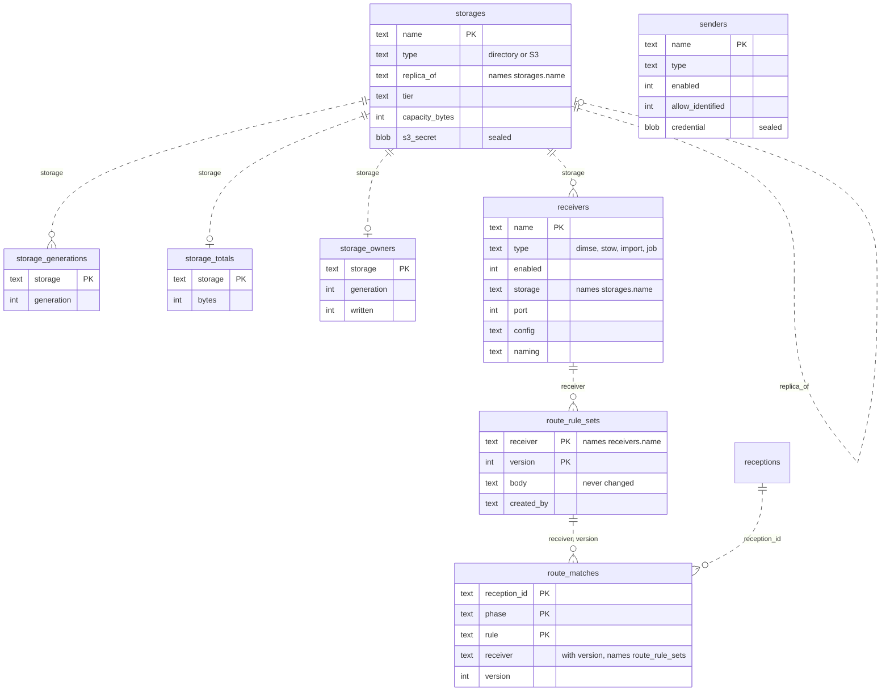

A receiver is of type `dimse` on a port of its own, or of type `stow`, `import` or `job` on
no port; a check holds that. `replica_of` makes a storage a replica of another
([replicas and repair](#replicas-and-repair)). `route_rule_sets` holds each version of a
receiver's routing rules, and two triggers (SQLite) or one trigger (Postgres) refuse any
update or delete of a row, so a version never changes and still reads after its receiver is
removed. `route_matches` records which rules a reception was routed by. `storage_owners` holds
the generation of the owner record this database last wrote on each storage, so a server finds
that another installation has taken the storage over; `storage_totals` holds the bytes the
catalog holds on a storage, and `storage_generations` how many switches changed the place a
name names.

### Receptions and the quarantine

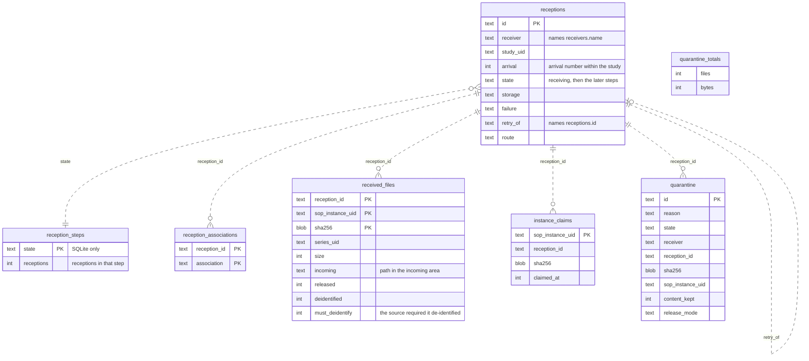

A unique index keeps one arrival number per study (`study_uid`, `arrival`), and another
keeps at most one reception of a study in the state `receiving` at one receiver, so two
opens at once make one, in either database. On SQLite, three triggers on `receptions` keep
`reception_steps` (the receptions in each step) in the transaction that writes the state,
so a status reads one row per step instead of counting. The state of a reception and the
reason of a quarantine record have no CHECK, because a later version adds to each.
`received_files.deidentified` says the file was recorded at a receiver that de-identifies, and
`must_deidentify` that its source (a transfer) required it de-identified: the archive step holds
a file with the second flag whose receiver no longer de-identifies, and its quarantine record is
marked de-identified, so it is released only through a receiver that does.
`instance_claims` holds an instance a reception claims before it writes the file, in flight only:
a SOP Instance UID is claimed or held, never both. `quarantine_totals` is a single-row running
total of the files held and their bytes.

### The catalog

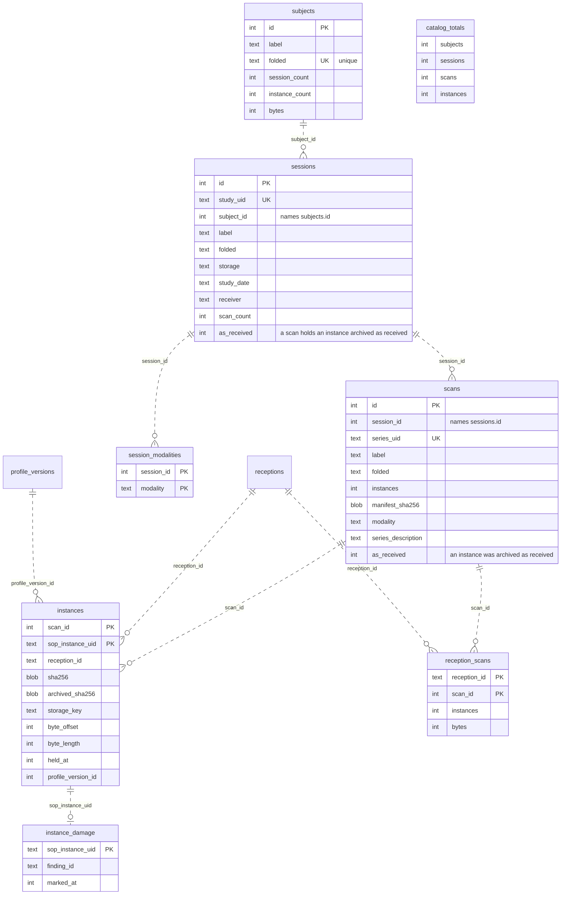

Subject, session and scan are the three levels of the catalog, and `instances` is where a
file's bytes are found (`storage_key`, `byte_offset`, `byte_length`). A label is unique at
each level, compared in its folded form: `subjects.folded`, `(subject_id, folded)` on
sessions, and unique indexes on `(subject_folded, folded)` and
`(subject_folded, session_folded, folded)` so a session or scan is found by its labels. A
SOP Instance UID is unique across the whole tenant (the unique index `instances_by_uid`).
The counts on a subject, session and scan are columns, and `catalog_totals` is a single-row
total. `as_received` on a scan is set when an instance it holds records no profile version
(it was archived as received), and on a session when one of its scans is: the commit that adds
such an instance sets it, and every write that removes, replaces or changes the profile of an
instance, and a rebuild, works it out again from the rows beneath, in the same transaction.
The catalog's lists for a key that may not learn original values filter and mark by this column
and read no instance. A delete moves these rows to [the hidden tables](#rows-a-delete-hides).

### Work and events

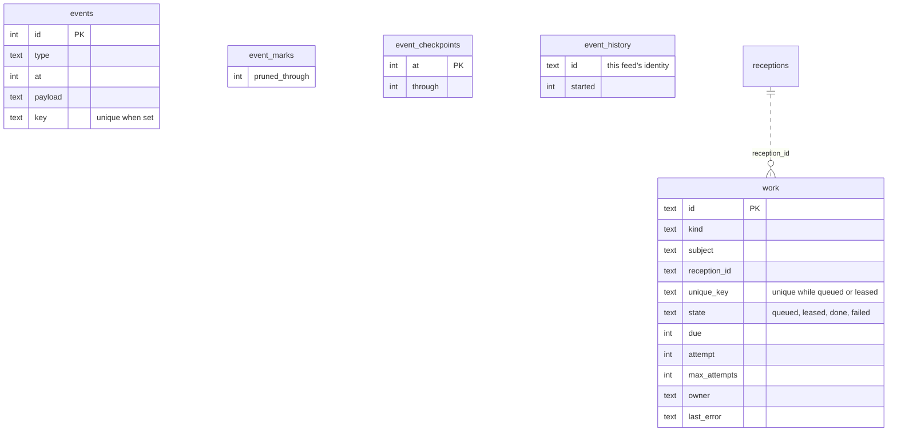

`work` is the leased queue: a unit is queued, leased to an owner until a time, then done or
failed, and an attempt count and a due time give the retry. A unique index on `unique_key`
over the queued and leased units means a key queues its work once, and a finished unit
frees it. `events` is the feed delivered to subscribers, with its own increasing id; a
unique index on `key` (where set) keeps an event written twice once. `event_marks` holds
how far the feed was pruned, so a reader whose cursor is below it is told its cursor expired.
`event_checkpoints` records, with the server's own clock, the newest event committed at a time,
so an event's age for retention is never the time the event itself carries. `event_history` is
a single row made with the database.

### De-identification

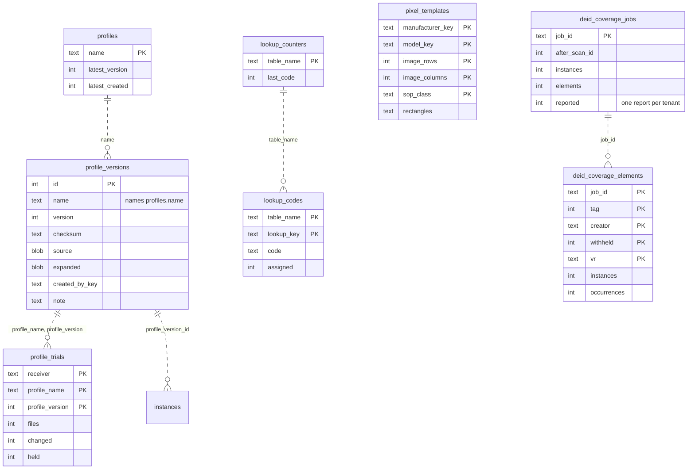

A profile version is never changed once written: its document and its expanded form are kept
as the exact bytes their checksum covers, and `id` is what an instance records
(`instances.profile_version_id`) while a person names a version by `(name, version)`, which is
unique. `profile_trials` records what trying a profile version over a receiver's latest receptions found, as counts only. `lookup_codes` holds the
codes assigned for a lookup table, with a unique index so one code is given once in a table,
and `lookup_counters` the last one given. `pixel_templates` hold the rectangles of burned-in
text by manufacturer, model, size and SOP class. A coverage job is a kind of job
([send jobs](#send-jobs)); the unique index on `reported` (where it is 1) keeps one job as the
tenant's report.

### Send jobs

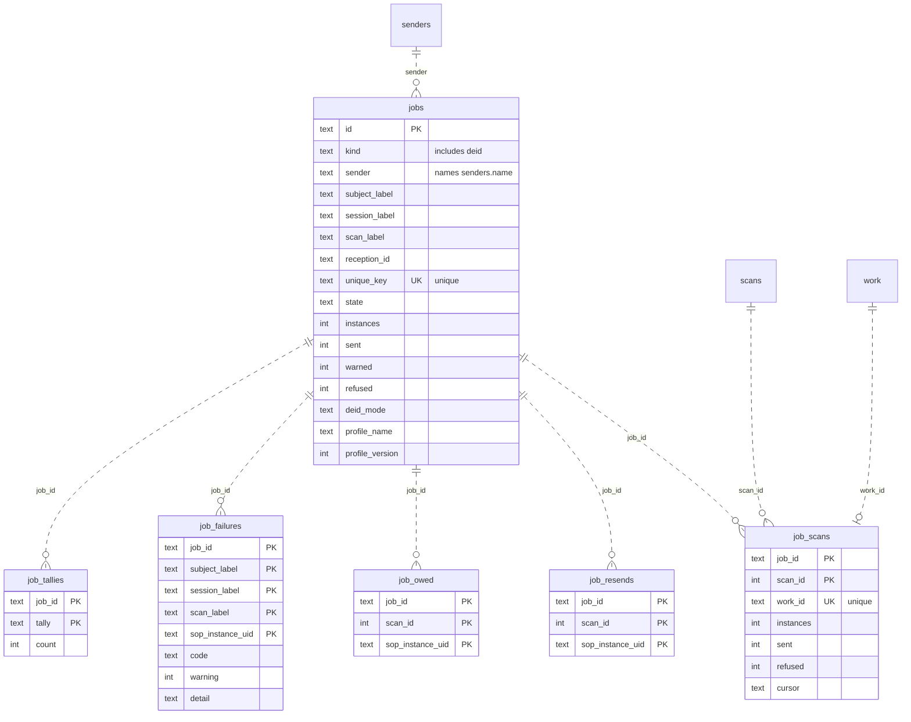

`jobs` is the common part of every job: a send, an import, a scrub, a repair and the others
all have a row here, and the kind-specific tables in the other areas hold "the job's own
part" keyed by the same `job_id`. A unique index on `unique_key` means a forward is made
once per reception and sender. Checks hold that a job is of kind `deid` exactly when it has a
`deid_mode`, and that its sent, warned and refused counts, and their bytes, never add up to
more than its instances and bytes. `job_scans` is one scan of a job and the unit of work that
carries it (`work_id` is unique). `job_failures` lists the instances that failed or warned, and
`job_tallies` holds a de-identification job's counts per key.

### Imports and transfers

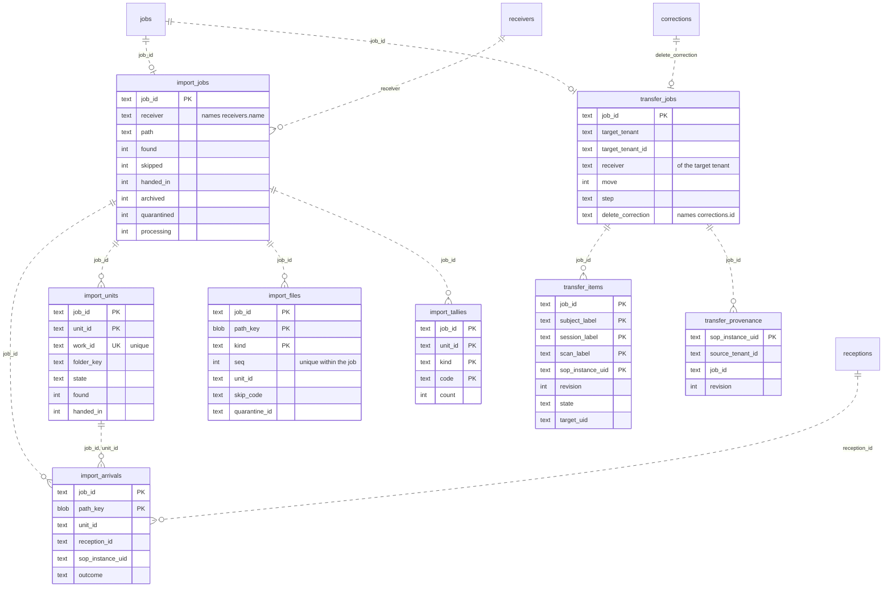

An import job walks a folder tree in units, one folder each (a unique index on `folder_key`
within the job, and one on `work_id`). Its counts are held by checks: what was found is what
was skipped plus what was handed in, and what was handed in is what was archived, already held,
quarantined, lost, failed, discarded or still processing, on the job and on each unit. A
path an index holds is at most 2048 bytes in both drivers. A transfer job copies a scan list
into another tenant: `target_tenant` and the receiver it names there are named, not enforced,
and the runner reads them again at each step. `transfer_provenance` records, on the target,
where a copied instance came from, and holds no UID of the source.

### Scrub and rebuild

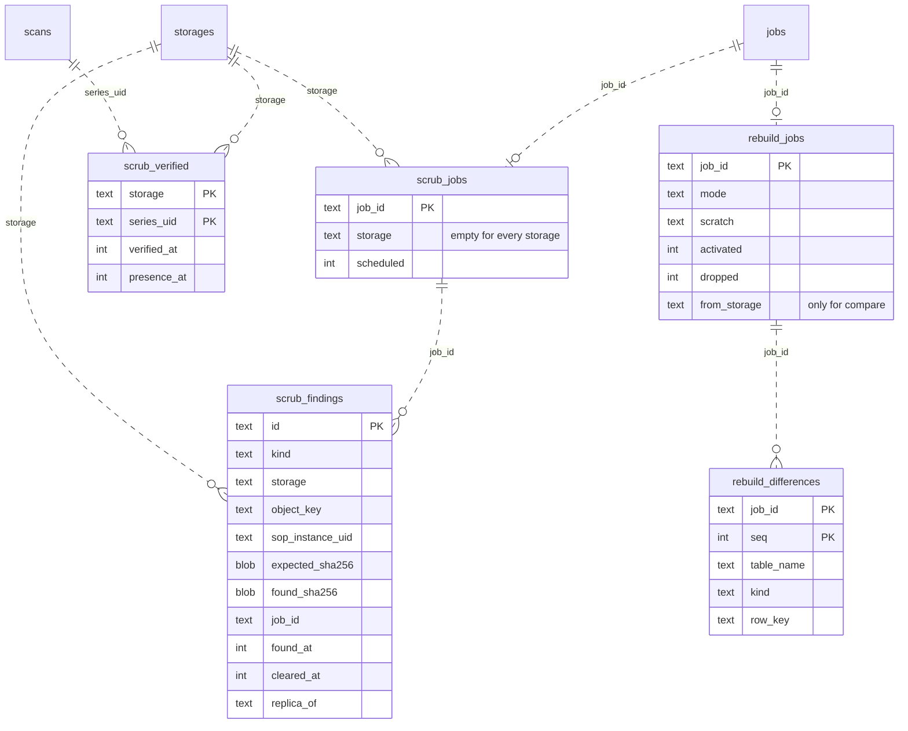

A scrub job reads every stored object of one storage (or of every storage) again and compares
it with the catalog and the scan's manifest; a finding is one disagreement. A unique index on
`(storage, object_key, kind)` over findings not yet cleared keeps one open finding per object
and kind. A check holds that a finding with a clearing job is cleared. `scrub_verified` is the
coverage: when each scan was last verified on each storage. A rebuild job makes the catalog again from what the storages hold
into a shadow catalog, never into the one in use: in compare mode the shadow is compared with the
catalog and dropped, and `rebuild_differences` keeps the first 1000 differences; in replace mode one
transaction makes the shadow the catalog, and sets `activated`, which never changes after.

### Replicas and repair

```mermaid
erDiagram
    storages
    scans
    scrub_findings
    replica_totals {
        text replica PK
        int pending
        int copying
        int damaged
        int backfill
        text last_fault
    }
    replica_scans {
        text replica PK
        text series_uid PK
        text state "pending, copying, in_step, damaged"
        int queued_at
        int due
        text owner
        int lease_until
        int verified_at
    }
    replica_damage {
        text replica PK
        text series_uid PK
        text sop_instance_uid PK
        int revision
        text finding_id
    }
    scan_sidecars {
        text series_uid PK
        blob manifest_sha256
        blob sha256
    }
    recalls {
        text storage PK
        text object_key PK
        text state
        int online_until
    }
    repairs {
        text id PK
        text finding_id
        text storage
        text object_key
        text from_replica
        text job_id
        int repaired_at
        text outcome
    }
    repair_jobs {
        text job_id PK
        text storage
        text from_replica
        text findings "JSON array of finding ids"
        int automatic
    }
    replicate_jobs {
        text job_id PK
        text replica
        text primary_name
        int scheduled
    }
    repair_outcomes {
        text job_id PK
        text finding_id PK
        text outcome
        int bytes
    }
    storage_switches {
        text id PK
        text primary_name
        text replica_name
        text state
        text step
        text confirm_token UK "unique"
        int generation
        int ended_at
    }
    storages ||..o| replica_totals : "replica"
    storages ||..o{ replica_scans : "replica"
    scans ||..o{ replica_scans : "series_uid"
    storages ||..o{ replica_damage : "replica"
    scrub_findings ||..o{ replica_damage : "finding_id"
    scans ||..o| scan_sidecars : "series_uid"
    storages ||..o{ recalls : "storage"
    scrub_findings ||..o{ repairs : "finding_id"
    repair_jobs ||..o{ repairs : "job_id"
    repair_jobs ||..o{ repair_outcomes : "job_id"
    storages ||..o{ replicate_jobs : "replica"
    storages ||..o{ storage_switches : "primary_name, replica_name"
```

A replica is a storage with `replica_of` set, and `replica_scans` is the queue of scans it
still has to copy: checks hold that a row is `in_step` exactly when it has no `queued_at`, and
`copying` exactly when it has a `lease_until`. `repairs` holds one mend of one damaged object,
with checks that tie its outcome to its `repaired_at` and keep its open work, attempt and hold
time all set or all null; a finished repair holds no open work. `repair_jobs` and
`replicate_jobs` are the own parts of those job kinds. `scan_sidecars` holds the digest of each scan's metadata file beside the manifest digest it was
written with. `recalls` holds one recall per object of an archive-tier storage, shared by every
request waiting for it. `storage_switches` is the move of a primary to a replica; its confirm token is
unique and checks tie its ended and swapped times to its state.

### Corrections

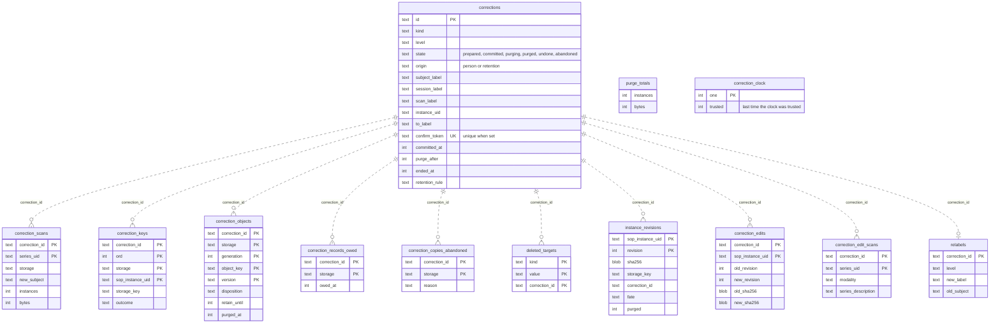

A correction is an edit, a relabel, a move or a delete, and it goes forward from `prepared` to
`committed`, then to `purging` and `purged`, or back to `undone` or `abandoned`. Checks hold
that a committed correction has a purge time and one not committed does not, that a correction
is ended exactly when it is purged, undone or abandoned, that it came from retention exactly
when it names a retention rule, and that an override of retention carries its reason.
`instance_revisions` keeps every revision of an instance so an edit can be undone until its
purge; `correction_objects` lists the stored objects a correction replaced and when each may be
purged. `purge_totals` is a single-row total and `correction_clock` is the last time the
server's clock was trusted for an automatic purge.

### Rows a delete hides

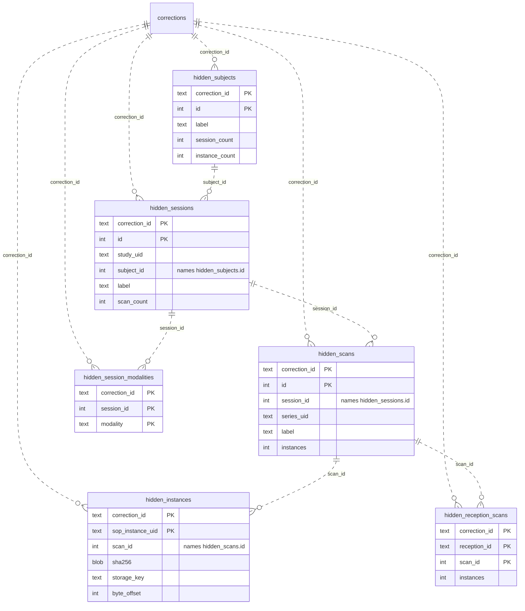

When a delete commits, its transaction moves the catalog rows it hides into these tables, each
with the same columns as its catalog table plus the correction's id. No read of the catalog
sees them, an undo moves them back as they were, and a purge removes them. They take no CHECK
of their own, because they hold only rows the catalog held. The search rows a delete hides are
in [search](#search).

### Retention, holds and batch deletes

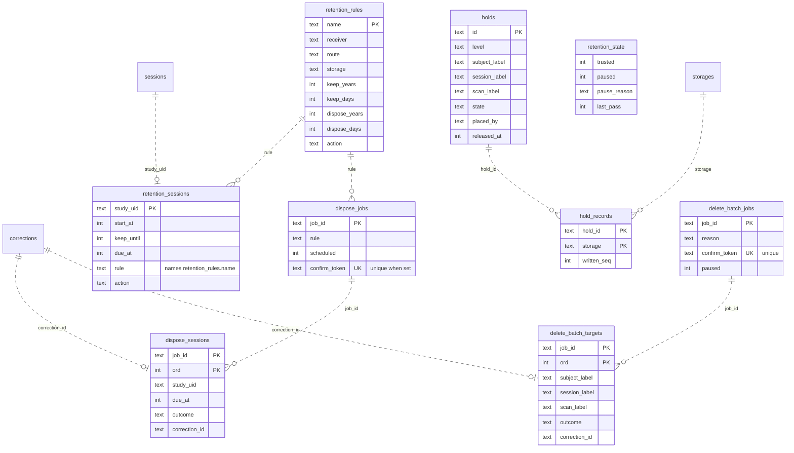

A retention rule says how long to keep a session and when to dispose of it; a rule must set at
least one of its four durations. `retention_sessions` holds the clock of each session, and a
check holds that a session has a due time exactly when it has a rule. A dispose job and a batch
delete job each list their sessions or targets and record the correction made for each in
`correction_id`. A hold names a subject, session or scan by its labels, as the catalog has them now; checks hold that a hold is released exactly when it has a release time, and that only
an active hold can be releasing. `hold_records` says on which storages the hold's record goes and the count it was last written at.
`retention_state` is a single-row state of the daily pass, and a check ties `paused` to its
time. A dispose job made by a person carries the confirm token of its preview, used once, and
the daily pass has none.

### Search

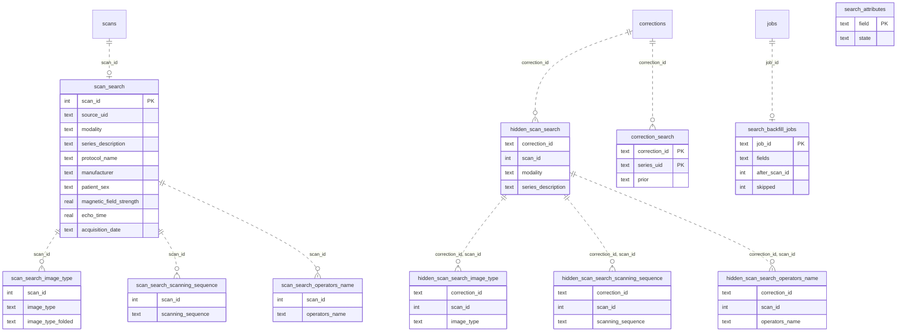

`scan_search` holds one row per scan with the header values a search reads, each text value
with a folded copy for case-insensitive compare; the three child tables hold the attributes
that have several values (image type, scanning sequence, operators' names). The hidden tables
are what a delete moves out, as the hidden catalog tables are. `correction_search` keeps the edits a correction made to a scan's row, as the row was before, so an
undo gives the values back. The tables with a `scan_id` and no primary key are indexed by it and by value. Three text columns are also searched by
substring: SQLite keeps three trigram full-text tables beside `scan_search`, with three
triggers that keep them in step with every write, and Postgres uses trigram indexes on the
same columns. `search_attributes` records which attributes are ready to search, and the
backfill job fills them for scans archived before.

## Where SQLite and Postgres differ

The two drivers have the same tables and columns, with the exceptions below. Both reject a
wrong type, and the contract suite runs unchanged against both.

| | SQLite | Postgres |
|---|---|---|
| Tables | `STRICT`, so a value of the wrong type is refused; 61 tenant tables are also `WITHOUT ROWID` | plain tables |
| Times | `INTEGER` microseconds since 1970 in UTC, null for "never" | `timestamptz`, read back in UTC |
| Checksums | `BLOB` with a `CHECK` on its length | `bytea` with a `CHECK` on its length |
| Flags | `INTEGER` of 0 or 1 with a `CHECK` | `boolean` |
| Counts and sizes | `INTEGER` | `bigint` (or `integer`) |
| Row ids | `INTEGER PRIMARY KEY` | `bigint GENERATED ALWAYS AS IDENTITY` |
| Text order and uniqueness | byte by byte by default | every compared name, id or UID is `COLLATE "C"`, to match |
| Audit `details` | `TEXT` | `jsonb` |
| Constraints | unnamed | named, so the driver tells a violation by its name |
| Single-row tables | `one INTEGER PRIMARY KEY CHECK (one = 1)` | `only_row boolean` in `quarantine_totals`, `catalog_totals`, `event_marks`, `event_history` and `purge_totals`; `one bigint` in `correction_clock` and `retention_state` |
| `reception_steps` | a table kept by three triggers on `receptions` | not made |
| `tenant_identity` | not made | a one-row table naming the tenant that owns the schema |
| Rule set versions never change | two triggers (before update, before delete) | one trigger function (before update or delete) |
| Substring search of scans | three `fts5` trigram virtual tables, with three triggers keeping them in step | the `pg_trgm` extension and three GIN indexes |
| Foreign keys | the master's two, with `foreign_keys` turned on for each connection | the master's two |

So the tenant has 109 tables in each driver and 110 across both: `reception_steps` on SQLite and
`tenant_identity` on Postgres each have no counterpart. The master's seven tables are the same
in both.

## How the schema is checked

`make check-tenant-sqlite` creates a tenant on SQLite and reads its tables, constraints and
rows back with the `sqlite3` tool ([scripts/check/tenant-sqlite.sh](../../scripts/check/tenant-sqlite.sh)),
and `make check-tenant-postgres` does the same with `psql` and `pg_dump` against a Postgres
you name ([scripts/check/tenant-postgres.sh](../../scripts/check/tenant-postgres.sh)); the master's
are `make check-master-sqlite` and `make check-master-postgres`
([gates and outside checks](gates.md)).
