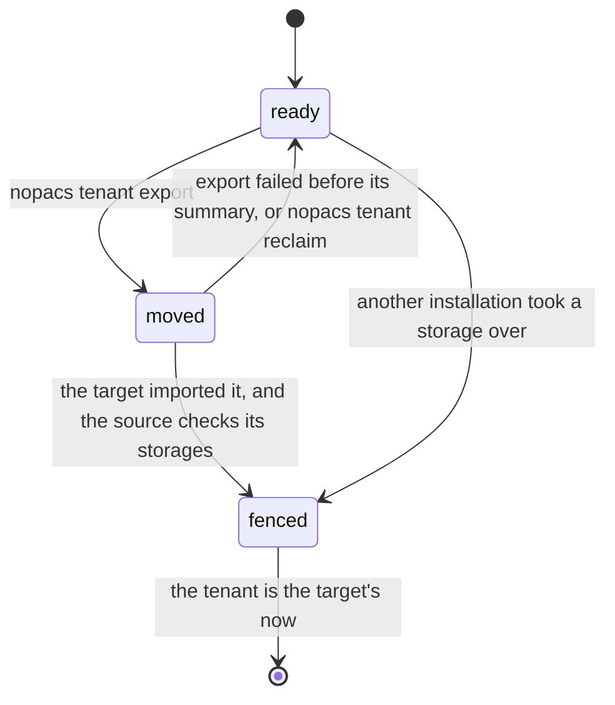

# Backup, restore and moving a tenant

[Documentation index](../README.md) · [The command line](../use/command-line.md) · [Running NoPACs](running.md) · [Correcting archived data](../use/correcting.md)

Three jobs share this page: a **backup** of a whole installation, a **restore**
of it onto an empty data directory (or the reconcile of databases a site
restored by its own point-in-time recovery), and the **move** of one tenant to
another installation. A backup is made either over the API while the server runs
(`nopacs backup create`, by an installation admin from any machine that reaches
the server) or on the machine itself with the server stopped (`nopacs-server
backup create`); both write the same file. A restore runs on the machine, with
the server stopped. A move starts on the running server and ends with the import
on the other machine, with that machine's server stopped. The rules are in the comments of
[`backup`](../../internal/backup/doc.go) and of the contract's
[`backup.proto`](../../api/proto/nopacs/v1/backup.proto) and
[`tenant.proto`](../../api/proto/nopacs/v1/tenant.proto).

## What a backup holds

A backup holds what the archive cannot make again from its storages:

- the master database: the tenants, the keys (stored hashed, as they always
  are), the grants, the installation's settings and its audit log;
- each tenant's database: its configuration (receivers, storages, senders,
  profiles), its jobs and receptions, its quarantine records, its corrections,
  and its sealed secrets.

It does not hold:

- **the catalog** (subjects, sessions, scans, instances and the totals derived
  from them). A restore rebuilds it from the storages, so it can never be older
  than the bytes it points at;
- **the storages**: the DICOM files and the records beside them are not copied.
  Back them up with the tools of the place they live in (a disk's, a bucket's).
  A restore expects to find them where they were;
- **the bytes in the incoming area** of the server's disk: files a sender was
  told were received but that were not archived yet, and the bytes of held
  quarantined files. Their records are in the backup; the bytes are not;
- **the TLS files** receivers and senders name, in each tenant's TLS directory
  (`tls/<tenant>/` in the data directory), nor the network listener's
  certificate and key named when the server starts. The configuration that names
  them comes back; the files are the site's credentials, kept with them.

Each database is read as of one moment, its *recovery point*. Anything changed
after it is not in the backup.

## Make a backup while the server runs

```sh
nopacs backup create --out /backups/nopacs-2026-11-24.backup
nopacs backup create --out /backups/nopacs-2026-11-24.backup --json
```

It needs the admin role on the installation (`BackupService.CreateBackup`); an
operator, or a tenant's admin, is refused. The server goes on receiving and
serving meanwhile.

- **Where it is encrypted.** The server encrypts the file with the key derived
  from the installation key file, exactly as the offline command does, before a
  byte leaves it. The client never sees a key, and the file opens only with that
  key file.
- **The file.** It is written beside `--out` (mode 0600) and given its name only
  once the server's summary has come and the size and SHA-256 of what was
  written are the summary's. A backup cut short, by the network, the client or
  the server, leaves nothing; a file already at `--out` is never replaced (exit
  5). `--json` prints the summary: format, installation, time, size, SHA-256, key
  version, and each section with its recovery point.
- **Its moments.** The master database is read first, then each tenant's in turn,
  each in a read transaction of its own, so each section stands for its own
  moment, seconds apart from the others. A restore needs no more: each tenant is
  reconciled on its own from its own recovery point (its correction records
  newer than it applied, its catalog rebuilt from the storages as they are at
  the restore), every key comes back suspended, and a tenant created or removed
  while the backup ran makes it fail, so the master never names a tenant it holds
  no section for. The audit's sealing pass is paused for the whole backup: a
  pass that comes due is skipped, not waited for, and the first pass after the
  backup seals what was written meanwhile. So no database is read holding an
  anchor of a checkpoint another, read earlier, does not hold.
- **What it holds open.** A read transaction takes no lock: receptions,
  changes and the event feed go on while it is open, on SQLite and on Postgres
  alike. What it costs is space while it is open: SQLite's write-ahead log
  cannot be reset past it, and on Postgres the read transaction holds back
  vacuum for the **whole cluster** (every database on that server keeps the old
  row versions the backup may still read). The server sends the file as it
  reads it, at most 1 MiB held at a time, so a client that reads slowly makes
  the reads wait.
- **How long it may run.** A client that reads nothing for 5 minutes is cut off
  by the server's write stall bound. A client that reads slowly but steadily
  passes that bound at every write, so the whole backup is bounded by the
  installation's setting `backup.max-duration` (default `6h`, from `1m` to
  `7d`, read when each backup starts): past it the backup stops at its next
  row or write, the stream ends without its summary, answered resource
  exhausted naming the setting (exit 7), and the entry that ends it says
  `max_duration`. Until then it holds the read transaction, the pause of the
  sealing pass and the server's one place for a backup or an export. Change it
  with `nopacs setting set backup.max-duration 12h`.
- **A key revoked meanwhile.** The caller's key is checked again every 15
  seconds while the backup runs, and one that may no longer back up ends it,
  answered as a new request would be. While the server waits on a client that
  reads nothing, no byte leaves, and the stall bound ends it.
- **One at a time.** One backup or tenant export runs on a server at a time;
  another is answered resource exhausted (exit 7).
- **Whole or nothing.** A tenant that is not ready (unreachable, failed,
  upgrading) fails the backup, naming it. A moved or fenced tenant is backed up
  as it stands.
- **Audited.** One entry in the installation's log when the stream opens,
  written before anything is read (a backup whose entry cannot be written is
  refused, unavailable), and one when it ends, with the size, the SHA-256 and
  the tenants held, or with how it failed.

Check it with `nopacs-server backup verify FILE` on a machine that holds the key
file (below).

## Make a backup with the server stopped

The command takes the data directory's lock, so it refuses while a server runs
on it.

```sh
nopacs-server backup create --data-dir /var/lib/nopacs --out /backups/nopacs-2026-11-22.backup
```

The flags are `--out` (required) and `--master-env`, the name of an environment
variable holding the master database's address when it is not SQLite in the data
directory. The data directory is `--data-dir` or `NOPACS_DATA_DIR`.

- The file is written beside `--out` with mode 0600 and renamed over it only
  once it is whole, so a failed backup leaves nothing.
- A backup is of the whole installation or nothing: a tenant whose database does
  not answer fails it.
- The command prints the file's size and SHA-256, each database's recovery point
  with its count of tables and rows, and the key version.

**Encryption.** The file is encrypted with a key derived from the installation
key file (`key` in the data directory), so it opens only with that file, and the
sealed secrets inside it are useless without that file anyway. Keep a copy of
the key file **apart from** the backup: with the backup alone nothing can be read,
and with the backup but not the key file nothing can be restored.

### Check a backup

```sh
nopacs-server backup verify /backups/nopacs-2026-11-22.backup --key-file /safe/nopacs.key
```

`verify` reads the file whole and checks what a restore checks before it writes
anything: every chunk authenticated with the key file, the layout and every
count, each section's SHA-256 against the footer, the end of the file, and that
each schema version is one this build restores. It writes nothing and may run
while the server runs. Without `--key-file` it uses the key file of the data
directory (`--data-dir` or `NOPACS_DATA_DIR`).

It prints what the backup holds and what a restore of it could not bring back:
per tenant, the files of unfinished receptions and the held quarantined files
whose bytes were in the incoming area. It does not read the storages, so it
cannot say what a restore will find there.

Check a backup after copying it, and now and then by restoring one on a spare
machine.

## Restore

A restore loads a backup into a data directory that is absent, empty, or holds
only the key file. The server must not run: the restore takes the same lock.

```sh
nopacs-server backup restore /backups/nopacs-2026-11-22.backup \
  --data-dir /var/lib/nopacs --key-file /safe/nopacs.key
```

The flags are `--key-file` (default: the data directory's), `--master-env` (the
variable holding the address of an *empty* database for the master, when it is
not SQLite in the data directory), `--scratch-schema` (the Postgres schema a
tenant on Postgres has its catalog rebuilt in; it must exist, and the tenant's
own database must be empty) and `--take-over`.

What it does, in order:

1. **Checks the whole file** before writing anything: every chunk, every
   section's SHA-256, every schema version. A file that fails changes nothing.
2. **Loads each database** at its own schema version and brings it to this
   build's.
3. **Reads every storage's owner record** of every tenant, writing nothing
   ([When `--take-over` is needed](#when---take-over-is-needed)). A tenant one
   of whose storages carries another installation's record (handed off by an
   export and imported there after the backup) is not reconciled: it is left
   *fenced* in the master, with the record's words as its reason, serving no
   data, its storages untouched, and the report names it; the other tenants are
   restored. Any other refusal stops the whole restore before any key is
   suspended or any storage taken: a storage refused after others were taken
   over would leave those taken from whoever writes them now.
4. **Suspends every key** (below).
5. **Reconciles each tenant with its storages**, one tenant at a time:
   - the owner record on each storage is taken one generation further, so no
     other installation still writing the storage goes unnoticed (see
     [Fenced](#fenced));
   - the correction records on the storages, which may be newer than the
     backup, are read. A record that does not verify under this key file for
     this tenant is treated as if it were not there, and reported. One that
     verifies is the tenant's own word, read by the same rule a rebuild reads a
     record with no row by. A record with no row in the backup becomes a
     correction as it says: a delete abandoned or undone shows its data; a
     delete committed, purging, purged, or still prepared (no one knows how it
     ended) holds its data hidden, left *unresolved* until an admin undoes or
     purges it, since no data is purged on a record's word; a relabel or a
     replace published is left unresolved, one prepared or abandoned is
     abandoned. A row the backup holds still prepared (the backup was taken
     before its request was answered) is moved to the state its record says,
     in the same way, and reported; left prepared, the server's start would
     roll it back against what the storages hold. A delete the backup holds
     committed whose record says undone is undone, its data shown: the record
     is written only once the undo has committed, and the delete kept would be
     purged after its grace. A delete whose row the backup holds prepared and
     whose record still says prepared (published and answered, its record's
     rewrite failed; or never published, which the record cannot tell apart)
     is taken as committed, its data hidden, and held unresolved until an admin
     undoes or purges it: shown, a withdrawn subject would be served again. A
     record of a purge over a row the backup holds committed leaves the row as
     it is, and is reported;
   - a delete of a subject made from its record holds, like the delete itself,
     data arriving under every label the subject had before a relabel, not only
     the label its record names, once every record (a relabel's among them) is
     read;
   - every delete the backup holds committed that the restore keeps is left
     *unresolved*, and none is purged until an admin confirms it: an undo made
     after the backup whose record was not rewritten looks the same as no
     undo, and a purge cannot be taken back. The report counts them. Review
     them with `nopacs correction list <tenant> --kind delete` and
     `nopacs correction show`; undo one that was undone with
     `nopacs correction undo`, and confirm one with `nopacs correction purge`,
     which purges it now (there is no way to confirm one and let its grace
     period run on);
   - a rebuild job the backup holds queued or running (one a server was working
     when the backup was made, whose worker is gone) is canceled, with the
     reason `canceled: ended by a restore or a reconcile`, and its shadow
     removed (its file beside a SQLite tenant's database, or its tables in the
     scratch schema), since the restore's own rebuild is refused while another
     is not ended;
   - the catalog is rebuilt from the storages; a delete made committed from its
     record then hides its data in the rebuilt catalog as its publish would, so
     an admin's undo shows it again and a purge removes all of it, the scans'
     manifest and metadata included; a replace made committed from its record
     owns the revision it superseded, so its purge removes it;
   - a new event history begins, which tells every consumer of the feed to start
     again.
6. **Writes the installation's id last.** A restore stopped half way leaves a data
   directory the server refuses to start on, with a marker saying a restore was
   interrupted. Remove the contents of the data directory except the key file
   (and empty the Postgres schemas it filled), then run the restore again.

Then it prints what came back, and, per tenant, what is lost: configuration
changed after the recovery point (the storages show only what corrections did),
the receptions that were unfinished (the sender must send those files again),
the bytes of held quarantined files that were in the incoming area (their records
come back marked *incoming lost*), the events after the recovery point, and the
audit entries after it. The restore's own audit entry is in the master's log.
Under *external credentials to re-enter* it names, by file name only, each TLS
file a receiver or a sender names that the restored data directory lacks
(`sender peer: TLS certificate authorities ca.pem, TLS client certificate
client.pem, TLS private key client.key`): put each back in `tls/<tenant>/`
before that receiver or sender is used; without them a receiver does not listen
and a sender cannot connect. An import names them the same way.

Start the server afterwards with `nopacs-server serve --data-dir /var/lib/nopacs`.

### Keys come back suspended

A key revoked, or a grant removed, after the backup would otherwise work again.
So **every key is suspended** by the restore: it is refused for remote callers
(the same answer as for a key that is no good), whatever its row said.

Review the keys, then reinstate those that should work, on the machine's local
socket, where commands need no key:

```sh
nopacs key list --data-dir /var/lib/nopacs          # each shows as suspended
nopacs key revoke <id> --data-dir /var/lib/nopacs   # one that should stay ended
nopacs key reinstate <id> <id>... --data-dir /var/lib/nopacs
nopacs key reinstate --all --data-dir /var/lib/nopacs
```

`nopacs key reinstate` (`AccessService.ReinstateKeys`) clears the suspension of
the keys named, at most 1000 at a time, or of every suspended key with `--all`,
which prints only the count. A key named that is not suspended is left as it is
and said so. Each key reinstated has its own entry in the installation's audit
log, with the key's id as its object. Reinstating does not bring back a revoked
or expired key: it stays refused. Only the local operator may reinstate: a key
is answered permission denied whatever its grants, since every key may be
suspended and none may lift a suspension. Review which keys deserve it first:
that is the point of the suspension.

Rotating a key on the local socket (`nopacs key rotate <id>`) is the other way
back: the successor is shown once, holds the same grants, holder, networks and
client certificate, and is not suspended, while the old key stays refused. Use
it for a key whose secret may have leaked while the installation was down.

## Reconcile a site's own point-in-time recovery

A site may bring its databases back by its own means instead of a backup file:
a Postgres point-in-time recovery to a moment, a copy of the SQLite files (taken
with the server stopped, or online with SQLite's backup API, such as the
`sqlite3` program's `.backup`), a snapshot of the volume. Such a copy is
older than the storages: a delete, a relabel or a replace made after it is on
the storages and not in the databases, and a key revoked after it works again.
Before the server starts on it, reconcile it:

```sh
nopacs-server backup restore --reconcile-only --data-dir /var/lib/nopacs
MASTER_DB='postgres://...' nopacs-server backup restore --reconcile-only \
  --data-dir /var/lib/nopacs --master-env MASTER_DB --scratch-schema rebuild
```

No backup file is read. The installation must be in place: the key file in the
data directory (or `--key-file`), the master where the data directory or
`--master-env` says, and each tenant's database at the address the master holds
for it. The flags are those of a restore, without the file.

It refuses, changing nothing:

- a data directory a server or a restore runs on (it takes the same lock), and
  one a restore was interrupted in;
- an empty database (a recovery that did not restore it, or a mistyped address:
  it never fills one);
- a master with no installation id, one whose key check the key file does not
  open, or one of another installation than the data directory's id file names,
  each before anything is migrated, so a mistyped address that reaches another
  installation's master leaves it as it was;
- a database made from another baseline schema than this build's;
- an owner record that refuses the reconcile, other than another
  installation's (below): every storage's record is read before anything is
  written, so no key is suspended and no storage taken.

Then it does what a restore does after loading a backup, by the same code:
each database is brought to this build's schema; **every key is suspended**
([as after a restore](#keys-come-back-suspended)); and each tenant is
reconciled with its storages: owner records taken one generation further
(`--take-over` as for a restore), the correction records read against the rows
by the same rules (a record with no row, made after the copy, becomes a
correction as it says, a delete held hidden and unresolved for an admin; a
delete whose row stayed prepared is taken as committed and held unresolved
until an admin acts), every delete the database holds committed held
unresolved, a rebuild left queued or running canceled, the catalog rebuilt from
the storages, and a new event history begun, so a consumer's cursor from before
is refused with `EVENT_HISTORY_CHANGED` and starts again.

A tenant one of whose storages carries an owner record naming **another
installation** (handed to it by an export after the copy, and imported there)
is not reconciled: that installation writes the storage now. The tenant is left
*fenced* (read only) in the master, with the record's words as its reason, its
storages untouched and its rows and catalog as the copy holds them; the report
names it, and the other tenants are reconciled. Run the reconcile again with
`--take-over` only if you know that installation's claim is stale.

There is no backup to say when the copy was taken: each database's *recovery
point* is the newest rows it holds, and the report prints, per tenant, its
newest correction and newest reception, then what is lost as a restore's report
does: configuration changed after the point, receptions unfinished at it, events
and audit entries after it. The incoming area is in place, so a held
quarantined file whose bytes are there, of the recorded size and SHA-256, stays
held and can still be released; one whose bytes are missing or different is
marked incoming lost. The data directory's id file is written if it is missing.

A reconcile stopped half way leaves a marker the server refuses to start on, as
do `backup create` and `tenant import`. Run the reconcile again: each step reads
what the last one left, and the catalog is rebuilt whole again. If it says a
storage's owner record is ahead, the first run had taken it: run it with
`--take-over`.

### When `--take-over` is needed

On each storage a tenant writes there is an *owner record* naming the
installation, the tenant and a generation. Two installations must not write one
storage, so the restore refuses a storage whose record:

- names **another installation**: that installation took the storage over (a
  hand-off, or a restore of its own) and writes it now. The restore, and a
  reconcile in place, leave that tenant fenced and go on with the others. Leave
  the storage to it. Give `--take-over` only if you know its claim is stale:
  that installation is gone and will never write the storage again, since
  `--take-over` takes every storage, and the other installation's live tenant
  would be fenced in its turn;
- names another tenant, or this installation at a later generation than the
  backup (or the restored database) holds: a restore or a reconcile since took
  it over. Stop whatever else uses it, then run again with `--take-over` if the
  storage is yours to take back.

Do not use it to get past the refusal without knowing why it came.

`--take-over` writes the owner records; it does not change a tenant's state in
the master. A tenant that was *moved* (handed off by an export) or *fenced* at
the recovery point, restored or reconciled with `--take-over`, stays moved or
fenced and serves no data until `nopacs tenant reclaim <tenant>` takes it back,
which then passes, since its storages' owner records name this installation.

## Moving a tenant to another installation

A move takes a tenant, with its configuration and its record of corrections,
from one installation (the *source*) to another (the *target*), leaving the
storages where they are. Both installations keep their own key files: they never
meet.



### On the source: export

Run by an installation admin, on any machine that reaches the server:

```sh
nopacs tenant export lab1 --out lab1.export --key-out lab1.key
```

Both files must be new; neither is ever written over one that is there. The
server then:

1. makes the tenant **moved**: its reads are served while the storages' owner
   records still name this installation, every change is refused
   (FAILED_PRECONDITION, reason `TENANT_MOVED`), and its receivers refuse new
   files;
2. **drains** it: the reception pipeline stops (what it holds is archived or
   left in the incoming area with its place kept) and the background work of
   corrections finishes the step it is at. The drain waits up to 90 seconds;
3. takes the **owner record** of each storage one generation further;
4. streams the tenant's database without its catalog, encrypted under a
   **transfer key** made at random for this export. Every sealed value in it is
   opened with this installation's key file and sealed again under that key;
5. sends the summary with the transfer key last. The command writes the key,
   once, to `--key-out` with mode 0600, then puts the export at `--out`.

An export is refused while a rebuild of the tenant runs, while a correction of
it is prepared, or while another export or backup runs on this server (one runs
at a time).

If the command fails **before the summary**, no key reached anyone, and the
server gives the tenant back (ready again), with an audit entry saying so. Once
the export is whole the tenant **stays moved**, whether or not the command saw the
end of it. If the key file cannot be written after that, the tenant is moved and
its key is lost: reclaim it and export again.

Stop the tenant's senders' work first if it must not be cut: a job's unit in
flight stops, with its place kept.

**Carry the files safely and apart.** The export is useless without the transfer
key and the key is useless without the export, so send them by different routes
and delete both from the source machine and from any place in between once the
import has succeeded. Anyone who holds both can read the tenant's secrets.

### On the target: import

The target's server must be stopped. Before it, make the target's key and the
storages ready:

- the target must **list the tenant's storages**: a directory storage's root,
  by the same root name, in `storage.directory-roots`, or an S3 storage's
  endpoint. The files stay where they are;
- keys and grants stay with the source. Give the target's own keys grants on the
  tenant afterwards.

```sh
nopacs-server tenant import lab1.export --transfer-key lab1.key --data-dir /var/lib/nopacs
```

The flags are `--transfer-key` (required), `--master-env`, `--db-env` (the
variable holding the address of an *empty* Postgres schema to load the tenant
into; without it the tenant is SQLite in the data directory), `--scratch-schema`
(for a Postgres tenant's catalog) and `--take-over`.

It reads and checks the whole file under the transfer key first; nothing is
written if that fails. Then:

- the tenant's database is loaded, and every sealed value is opened with the
  transfer key and **sealed again under the target's key file**, so labels,
  remapped UIDs and date shifts stay what they were. The tenant keeps its name
  and its id;
- each storage's owner record is written naming the target, **one generation
  past the export's**. The source, at its next check of the records (within 30
  seconds if it is running, at once when it starts), fences the tenant: it
  writes nothing beside the target and serves none of the tenant's data;
- every correction record is **written again under the target's key**;
- the catalog is rebuilt from the storages and a new event history begins;
- the tenant is registered last, with an audit entry, so a tenant the server
  opens was taken over whole.

A tenant of the same name or id on the target refuses the import. A storage whose
owner record names an installation other than the source, or a later generation
than the export's, is refused unless `--take-over` is given. An import stopped half
way leaves the tenant's database, named in the message, and no tenant: remove that
database and run the import again.

Then start the target's server and give its keys grants on the tenant.

### Take a tenant back: reclaim

If no import followed, the source takes the tenant back:

```sh
nopacs tenant reclaim lab1 --data-dir /var/lib/nopacs
```

Only the **local operator** may run it, on the server's own socket: a key is
refused whatever its grants, because whoever runs the host knows whether the
import went ahead. It is refused while an export of the tenant is running. It
works only while the owner record on each storage still names this installation
and the generation the tenant holds; once another installation has imported, it
names that one and the tenant is not taken back.

Reclaim takes each owner record **one generation further** before the tenant
writes again. So the earlier export can no longer be imported: its generation is
older than the storages' now, and an import of it is refused unless `--take-over`
is given. Export again if the move is still wanted. A tenant already ready is
answered as it stands.

### Fenced

A tenant is *fenced* when the owner record on one of its storages names another
installation, another tenant, a later generation than the tenant's database
holds, or names this installation but does not verify under its key file. That
means another installation has taken the storage over (an import or a restore),
or the record is not one this installation wrote. A fenced tenant **serves no
data and writes nothing**: every request into it, a read of its catalog,
metadata, files (download, DICOMweb, `ReadFiles`), settings, audit or events as
well as a change, is refused as FAILED_PRECONDITION with a message that begins
`TENANT_FENCED` and names the storage and the installation that owns it. Only
its state and reason stay visible (`nopacs tenant show`, `tenant list`,
`nopacs status`). No other tenant is affected.

Why reads stop too: once another installation owns the storage, a delete, a
relabel or a replace made there never reaches this installation's catalog.
Serving from it would keep handing out what the new owner withdrew (the files
stay on the storage until its purge, after the grace), to keys the new owner
cannot revoke.

The server checks the owner records when a tenant starts, every 30 seconds, and
before each purge, relabel and replace step. A fence is kept in the master
database, so a restart does not lift it, and the server never lifts it itself.

An operator sees it in `nopacs tenant show NAME` and `nopacs tenant list`: the
state is `fenced` and the reason names the storage and why. What to do:

- after a move you made, nothing: the tenant is the target's now. Remove it here
  when you are sure (`nopacs tenant remove NAME --yes` unregisters it; its
  database and files stay where they are);
- if you did not expect it, find out which installation wrote the owner record
  before anything else writes that storage. `nopacs tenant reclaim` refuses a
  tenant whose record names another installation, so it cannot be used to
  override another installation's claim.

## What stays weak

- **The check is between writes, not a lock.** Two servers started against the
  same storages within one 30-second check of each other could both write until
  the next check.
- **The audit chain is not verified across a move.** The tenant's audit log and
  its checkpoints travel inside its database, but the target does not check them
  against the source's audit public key; the import's own entry is in the
  target's installation log.
- **Keys and grants do not travel.** The target needs its own keys and grants for
  the tenant.
- **The source serves reads with what it had until the import is seen.** On the
  old installation a moved tenant keeps the network rule
  (`access.tenant-networks`), keys and grants it had at the export, and serves
  reads to them while the storages' owner records still name it; tightening
  them on the new owner does not reach it, and the old installation cannot
  change the tenant's own rule any more. Once the import writes its own owner
  record, the source's next check (within 30 seconds; at once when it starts)
  fences the tenant and its reads stop; in that window, reads are still served
  from the catalog as it stood at the export. A stream already open (a
  `ReadFiles`, a download, a `Watch` of the tenant) is not cut by the fence.
  Revoke the old installation's keys for the tenant, or remove the tenant there
  (`nopacs tenant remove NAME --yes`), once the move is done.
- **Job units in flight** during a drain stop with their place kept; they are not
  finished. A sender's work that must not be cut should be stopped first.
- **Incoming bytes are not carried.** After a restore or a move, files a sender
  was told were received but not yet archived are gone, and the held quarantined
  files whose bytes were in the incoming area come back as records marked
  *incoming lost*. Senders must send them again.
- **The drain can fail.** If the tenant's pipeline does not stop within 90
  seconds the export fails and the tenant is given back; try again when it is
  quieter.
- **A backup's sections are moments apart.** Over the API each database is read
  in its own transaction, one after another; nothing a restore needs depends on
  one moment, but the report of what was lost is per tenant, each from its own
  point.
- **A slow client holds a read open.** A client that reads, however slowly, keeps
  the database it is reading in one transaction until that section is sent, up
  to `backup.max-duration`; only one that reads nothing for 5 minutes is cut
  off sooner. Meanwhile SQLite's log grows and Postgres's vacuum is held back
  across the cluster, and no export can run. Take a backup from a machine near
  the server.
- **No seal pass runs during a backup.** Passes that come due are skipped, so
  entries written during a long backup stay unsealed (removable without a
  trace) until the first pass after it.
- Restore and import are local commands by design.
- **A reconcile of a site's own copy knows no time.** Its recovery point is the
  newest rows each database holds; when the copy was taken is the site's to
  know. Files left in the incoming area are not taken back: held quarantined
  files are marked incoming lost even when their bytes are still on the disk,
  since the incoming area is not part of the copy and may hold another
  moment's files.
- **Storages are not part of a backup.** What a backup cannot bring back, the
  storages' own backups must.
