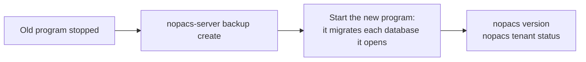

# Upgrading

[Documentation index](../README.md) · [Running NoPACs](running.md) · [Backup, restore and moving a tenant](backup.md) · [Troubleshooting](troubleshooting.md)

How the two programs and their databases change from one build to the next.

## Before anything is released

**No release exists yet, and a build made during development may change the schema of
the databases.** Until the first release, a change to a schema edits the first
schema in place instead of adding a step to it. A binary refuses to open a database
whose first schema differs from its own:

```
the database was made by an earlier development build (or is another kind of
database): ... a database made from another baseline schema is never migrated: make it again
```

The database is not changed and not half opened. A backup or a tenant export is also
refused by a binary of another schema, before anything is written, and a restore or an
import refuses a file made from other schemas. So during development:

- do not keep data you need in an installation made by a development build;
- to try a newer build, make a new installation, or send the data again.

## From the first release

From the first release a change to a schema is a **migration**: a numbered file
applied once, forward only, never edited after it is merged. The server applies the
migrations of the databases it opens when it starts, under a lock that holds across
processes, so two servers do not migrate at once.



A rule that never changes: a database a **newer** build has migrated is refused by an
older one ("the database is at schema version N and this binary knows only up to M"),
so going back to an older program means restoring the backup made before the upgrade.

## What to do for an upgrade

1. Stop the server (`Ctrl-C`, or SIGTERM: it finishes the requests in flight and
   writes the audit entries held in memory).
2. Make a backup with the old program: `nopacs-server backup create --out FILE`
   ([backup](backup.md)). The storages are backed up by their own tools.
3. Replace both programs. They are built together and carry one version.
4. Start the server. Watch its log: a migration that fails stops the start and leaves
   the database as it was.
5. Check `nopacs version`, `nopacs tenant list` and `nopacs tenant status <tenant>`.

## The key file

The installation's key file does not change in an upgrade. Keep it where you kept it.
A server started with another key file than the installation's refuses to start and
changes nothing.
