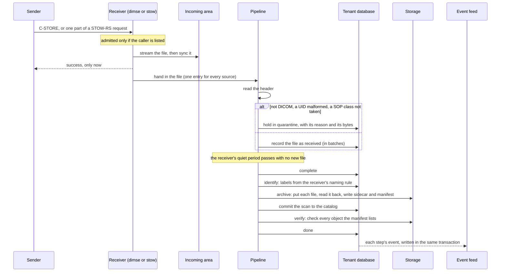
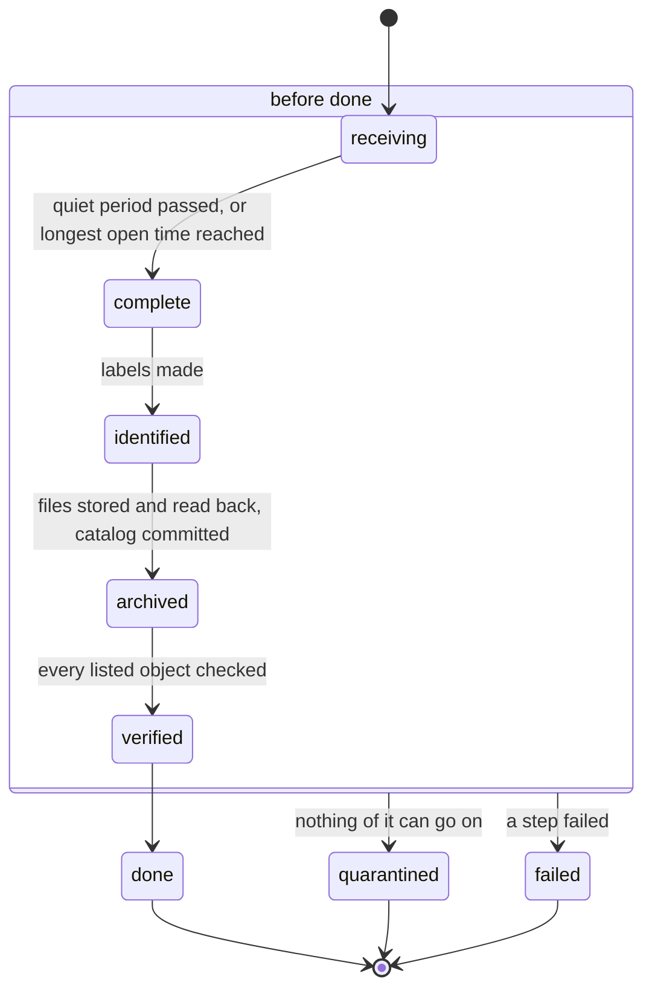

# A reception, end to end

[Documentation index](README.md) · [Architecture](architecture.md) · [Receiving through the API](api-walkthrough-reception.md) · [Reading the archive](reading.md)

A *reception* is the files of one study arriving at one receiver. This page
follows one from a sender's first file to a verified scan, and says how the
parts named in [Architecture](architecture.md) hand it on. Each part's rules are
in its `doc.go`: [receive](../internal/receive/doc.go) (the pipeline and what makes
a crash safe), [incoming](../internal/receive/incoming/doc.go),
[dimse](../internal/receive/dimse/doc.go), [stow](../internal/receive/stow/doc.go),
[supervise](../internal/receive/supervise/doc.go).

## The flow

Every step after the first is a leased unit of work held in the tenant's database,
so a step can be run again after a crash and changes nothing more. A file the
receiver acknowledged is never lost and never archived twice; the order of effects
of each step is in [receive](../internal/receive/doc.go).

## Its states

Done, quarantined and failed are ends. A file that arrives for a study whose
reception is past receiving does not reopen it: it starts a new reception of the
same study (a later arrival). So does running a quarantined or failed reception
again once its cause is fixed (`nopacs reception retry`), so a reception's history
is never rewritten. A single bad file is quarantined on its own and the reception
goes on with the others. A reception is complete when it is *quiet*, not when it
is whole: DICOM does not say how many files a study has
([core/reception](../internal/core/reception/doc.go)).

## What a person can do about it

- Watch it: `nopacs reception list`, `nopacs reception show`, the tenant's status
  and event stream (`MonitorService`), shown step by step in
  [Receiving through the API](api-walkthrough-reception.md).
- A quarantined file: `nopacs quarantine show --header`, then `release` or
  `reject` with a reason.
- A failed reception: `nopacs reception retry`, or `discard` with a reason.

Nothing is deleted from a storage by the pipeline, and a file leaves the incoming
area only after the database has recorded why. The commands are in
[the command line](command-line.md).
