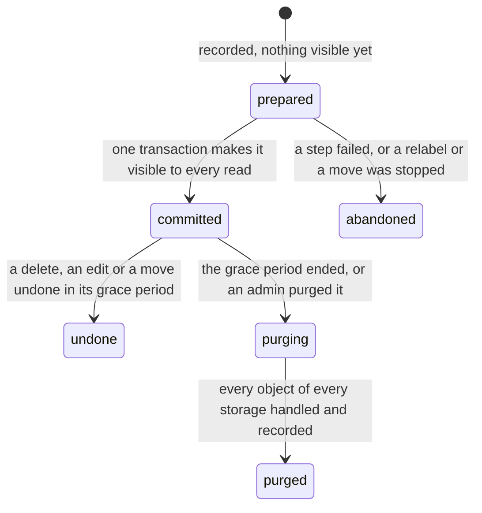

# Correcting archived data

[Documentation index](../README.md) · [The command line](command-line.md) · [Settings](../operate/settings.md) · [Retention rules and holds](retention.md) · [Replica storages](../operate/replicas.md)

A *correction* is a change to archived data made on purpose, with the reason a
person gave, and kept as a record for as long as the tenant is: a **delete** of a
subject, a session, a scan or one instance; a **relabel** of a subject, a
session or a scan; a **replace** of an archived instance by the corrected file a
sender sent again; an **edit** of named header values of every instance of a
subject, a session, a scan or one instance; a **move** of a session under
another subject, or of every session of a subject (a merge). Corrections are made with `nopacs correction` or
`CorrectionService`; the rules are in the contract's comments on
[`correction.proto`](../../api/proto/nopacs/v1/correction.proto) and in
[correct](../../internal/correct/doc.go).

Every reason is 1 to 1024 bytes in your own words ("consent withdrawn", "wrong
subject id at the scanner"), never a value read from a file: the correction, its
audit entry and its record on the storage keep it.

| What | Role on the tenant |
|---|---|
| delete, relabel, replace, edit, move, merge, undo, purge, allow | admin (never a masked key for an edit, a move or a merge) |
| list and show corrections | operator |

## The states of a correction



A correction is recorded in the tenant's database before anything is written to a
storage, and a record of it (`meta/.corrections/<id>.json`) is put on each
storage it touches before it is made visible, so a rebuild or a restore of the
tenant finds it even without the database. A step that fails before the change
is visible abandons it: what it wrote is removed, and nothing changed for any
reader.

## Delete

```
nopacs correction delete lab1 sub-3f9a --reason "consent withdrawn" --preview
nopacs correction delete lab1 sub-3f9a --reason "consent withdrawn"
```

1. **The preview.** The command first asks the server what the delete would
   remove and shows it: the subjects, sessions, scans, instances and bytes; the
   storages that hold it and what each will do with a removed object; the
   senders it was sent to; the jobs that would meet it; the quarantined files
   and the receptions its purge clears; the subject labels arrivals stay held
   under after the purge; and when its bytes would be purged.
2. **The confirmation.** Without `--yes` it asks for the target to be typed
   again; with no terminal it deletes nothing and exits 2.
3. **The delete.** It carries the preview's token, a value only this server
   makes, valid for an hour. When anything the preview showed has changed
   since (data arrived under the target, a job was made), the delete is refused
   (exit 5) and the command is run again, so a delete acts on what a person
   saw. The same token sent again with the same target answers the delete it
   made, so a client that lost the answer can send the request again; with
   another target it is refused (exit 5). The server remembers a used token
   only while it runs, and only its last 1024 or so: after a restart, or once
   forgotten, the repeat is answered not found (exit 4), since the target is
   hidden; `nopacs correction list` then shows the delete.

The data is hidden from every read at once: the catalog, DICOMweb, reads and
downloads answer as if it did not exist, and jobs that meet it count it as
deleted and go on. An instance delete hides that instance alone; at its purge a
new manifest of its scan without it is written.

### Many targets at once

```
nopacs correction delete-batch lab1 --file withdrawn.txt --reason "consent withdrawn" --preview
nopacs correction delete-batch lab1 --file withdrawn.txt --reason "consent withdrawn"
nopacs correction delete-batch lab1 --from-search "modality=SR receiver=old-gateway" --reason "test data sent by mistake"
```

A batch deletes many subjects, sessions or scans with one reason. `--file`
names them one `<subject>[/<session>[/<scan>]]` per line (blank lines and lines
starting with `#` ignored; `-` reads standard input); `--from-search` takes the
filters of `nopacs catalog scans` as `key=value` pairs (`modality`,
`description-prefix`, `receiver`, `archived-since`, `archived-until`) and makes
each scan found a target. A batch names at most the tenant's
`correction.batch-max` targets (10000, the most; an admin on the installation
may set a tenant's lower), each once, none inside another, and never one
instance.

1. **The preview** shows every target with its instances and bytes, the holds
   that cover it, the time a retention rule keeps it until, the replicas its
   purge reaches and the senders it was sent to, and how many targets are held
   or kept. It is answered under one token, bound to the targets in their order,
   the reason, and what each target's own delete preview answered, for an hour.
   Other targets, another reason, or a target changed since (data arrived, a
   hold placed) refuse it (exit 5). What a target's preview answers includes
   which rows of the catalog it takes and each scan's manifest checksum, so a
   label that came to name other data of the same size (two sessions swapped
   by relabels, an instance replaced or edited) counts as changed; a single
   delete's token is bound the same way.
2. **The job.** Confirmed (the tenant's name typed again, or `--yes`), the
   batch is a job of kind `delete_batch`. It deletes each target in turn by an
   ordinary delete with the batch's reason, made in the name of the key that
   confirmed it, so each delete has its records, grace period, undo
   (`nopacs correction undo` of that one delete), purge on every copy and audit
   entry, as any delete.
3. **What is skipped.** A target is never forced. When its turn comes it is
   previewed again: one a hold covers is skipped as `held`, one a rule keeps as
   `kept` (a batch never overrides retention), one whose preview answers
   otherwise than when the job was made as `changed`, one gone as `gone`, one
   another correction holds as `overlap`; any other refusal as `refused`, named
   in the server's log.
   `nopacs correction batch-targets lab1 <job>` lists each target with its
   outcome and its delete.

`nopacs job watch` follows the job; `nopacs job pause` stops it before its next
target and `nopacs job resume` (admin) lets it go on; `nopacs job cancel` ends
it, its targets not reached left as they are. The job ends done when every
target was deleted, partial when any was skipped, and failed when the key that
confirmed it may no longer delete (revoked, expired, suspended, no longer
admin). Its state is the database's: after a restart it goes on from the
target it stopped at, and a target whose delete was made just before the stop
is recorded deleted by that delete, never deleted twice. One batch runs per
tenant at a time. A masked key may neither ask for a batch nor resume one.

## The grace period, undo and the purge

The bytes stay on the storage, unserved, for the tenant's `delete.grace`
(`7d` by default, `0d` to `90d`; a tenant's admin may set the tenant's own).
The purge time is fixed when the delete is made: a later change of the setting
moves no purge already set, and no date read from a file is used.

- **Undo.** `nopacs correction undo lab1 <id> --reason TEXT` shows the data
  again, as it was, until the purge starts.
- **The purge.** The server runs a pass every minute that purges each
  correction whose grace period has ended. `nopacs correction purge lab1 <id>`
  purges at once (`--wait` waits until it ends). Each object is read for its
  size and SHA-256, compared with what was archived, removed through its
  storage, and recorded with what the storage said it did; the manifests and
  metadata last; then the catalog's rows. Nothing is undone once a purge has
  started. A purge stopped midway (a restart, a storage that does not answer)
  goes on by itself.
- **The clock.** A purge whose time came by itself waits while the server's
  clock reads earlier than a time it already recorded, or more than two days
  past the last time it trusted: a clock set back, or one that jumped forward,
  never ends a grace period early. An admin's purge trusts the clock it runs at.

### What "purged" means

`nopacs correction show` says, per storage, what the storage did with the
objects it purged, never more strongly than the storage said it:

| Disposition | What it means |
|---|---|
| removed | the bytes are gone from this storage: a file removed from a directory, an object deleted from an unversioned bucket, or every version deleted by its version id |
| hidden | the key answers not found, but older versions remain: a versioned bucket whose storage keeps them (`nopacs storage set --purge-versions=false`), or one the server was not allowed to delete versions in |
| retained | the storage refused, under its object lock, until the time it states |
| unknown | the server could not learn what the storage did |

A withdrawal is complete on a storage only where every object is removed.

On a bucket that keeps versions, an S3 storage deletes every older version
and delete marker of each object it purges, by its version id, unless it was
added or set with `--purge-versions=false` (`S3Storage.purge_versions` in the
API; absent means true). It may change at any time and changes only what
later purges do; `nopacs storage show` says which applies.

### What is kept

- **Objects a live row still uses**, and a manifest or metadata a reception
  rewrote since the delete, are left where they are and counted as kept, never
  as removed. `objects_owned` is every object the correction owns;
  `objects_removed` and `objects_kept` together reach it when the purge is done.
- **What names the deleted data**: the subject's label, each study's, series'
  and instance's UID. A file that matches one later is quarantined as
  `was_deleted`, with none of its bytes kept, rather than archived: a withdrawal
  holds against the next re-send.
- **The correction and its records**, for as long as the tenant is, so a
  restore from an older backup applies the delete again.

### Every copy of a storage

When a storage has [replicas](../operate/replicas.md), a correction reaches every copy:

- **Delete.** The purge removes each object from the primary and from every replica and
  records what each storage did, per storage. It is "purged" only when every object on every
  copy is removed and each removed key has been checked absent. A replica that does not
  answer holds the correction in `purging` until it does, so a withdrawal never ends with
  bytes left on a copy nobody sees. A correction's preview lists the replicas.
- **Records.** The correction's record is written to the primary and to each replica its
  target touches. A replica that cannot take it yet is owed it; until every record owed is
  put, no purge removes anything from that replica and a [switch](../operate/moving-off-a-storage.md) to it does not swap.
- **Replace.** The publish queues the scan for each replica to be copied again.
- **Relabel.** The new keys are copied to the primary and to each in-step replica before the
  one publish that makes the new labels visible.
- A replica attached while a purge runs joins that purge's copies, and its backfill never
  copies an object of a correction whose purge has started. A replica cannot be detached
  while a correction counts it, unless the detach says to abandon those purges
  (`replica detach --abandon-purges --reason ...`), and then the correction records that
  copy as unknown.
- A purge and a [switch](../operate/moving-off-a-storage.md) exclude each other: a switch
  is refused while a purge of its storages is unfinished, and a purge waits while a switch
  runs.

### Holds and retention rules

A delete of data a [hold](retention.md#holds) covers is refused (`HELD`), and a purge of it
waits. A delete of data a [retention rule](retention.md#rules) keeps at least until a time
to come is refused (`RETENTION_MINIMUM`); an admin **on the installation** may lift that
for one delete, with a reason:

```
nopacs correction delete lab1 sub-3f9a --reason "consent withdrawn" \
  --override-retention --override-reason "court order of 2026-11-03"
```

A tenant's admin who tries it is refused. See [retention and holds](retention.md) for why.

### Letting data arrive again

When a withdrawn consent is given again:

```
nopacs correction show lab1 <id>          # lists the values the delete holds
nopacs correction allow lab1 <id> --subject sub-3f9a --reason "consent given again"
nopacs correction allow lab1 <id> --study 2.25.1234 --reason "consent given again"
```

One value at a time, once the delete is purged, so a withdrawal is never
lifted wider than meant. A file matches a delete while any value it holds
matches the file, so a whole subject arrives again once each of its values is
allowed. Files quarantined as `was_deleted` before kept no bytes: the sender
sends them again.

## Relabel

```
nopacs correction relabel lab1 sub-3f9a --to sub-0042 --reason "wrong subject id at the scanner" --wait
```

Labels are part of every stored object's key, so a relabel copies each object
to its key under the new label, reads it back and compares its SHA-256, in the
background; readers see the old label until the whole target switches at once.
A lookup by the old label then answers not found. To a key with operator or
more on the tenant (the role that reads corrections), its message starts
`RELABELED:` and names the relabel and the labels the data has now (a catalog
read, metadata, `ReadFiles` or a download, for a subject, a session or a scan
under it); a reader is answered as for a label never used, since a relabel may
have taken an identifying label out of use. Once a later delete has hidden the
data, the old label answers a bare not found to everyone. The old objects stay,
unserved, until the correction's purge after the grace period. A relabel still
copying is stopped with `correction undo`, which removes its copies. A relabel
of the same target to the same label asked again answers the same correction.

While a delete or a relabel has not ended, the labels and UIDs it holds are not
used by an arrival: a file that would land on them is quarantined as a label
conflict naming the correction, and is released once the correction has ended.

## Replace

```
nopacs quarantine list lab1 --reason different-file
nopacs correction replace lab1 q_41Ab --reason "corrected file sent again by the site"
```

A file quarantined as a **different file** (a file under a SOP Instance UID the
tenant holds, with other bytes: the corrected file a sender sent again) or as
**repairing a damaged instance** replaces the archived instance. It is first
de-identified as its receiver's profile version says, as a release would, and is
never archived as received when that receiver de-identifies. The new bytes go
to the instance's next revision (`<UID>.r2.dcm`); the old revision stays,
unserved, until the purge. `ResolveInstances` answers, for an (instance,
revision) pair a platform kept, whether it is current, superseded, deleted or
unknown. A replace is not undone: the way back is another replace from the old
file.

## Edit

```
nopacs correction edit lab1 sub-3f9a/ses-81c2/scan-7 --set SeriesDescription="T1 axial" --reason "series named wrongly at the scanner" --preview
nopacs correction edit lab1 sub-3f9a/ses-81c2 --remove StationName --reason "station named by the site"
```

An edit sets, changes or removes named attributes (by keyword, or as
`gggg,eeee`) of every instance of its target, at most 2000 instances and 64
attributes; a larger target is edited a scan at a time. Each instance gets a
later revision written by the DICOM library, through the path a replace takes:
its bytes read and checked against the catalog, the changes made on its data
set, the new file judged, put at its revision key and read back, each scan's
manifest and metadata written to name the new revisions, then one transaction
publishes them all. The revisions it supersedes stay, unserved, until the purge,
and `correction undo` puts every instance back at them until then (the new
revisions removed from every copy). An edit being undone is never purged. An
undo that may no longer be published (a hold placed over the edit meanwhile, a
rebuild, a switch or a repair) is taken back: every scan names the new
revisions again, the edit stays committed, and the server's audit entry says
why; ask for the undo again once that ends. A revision number is never used twice for
an instance, so an edit made after an undone one numbers its revisions above
the undone edit's. A catalog value an edit sets (Series Description, Modality,
Series Number) is the scan's in the catalog from its publish. A new revision
is written in UTF-8 (Specific Character Set `ISO_IR 192`), as a de-identified
file is; its text reads the same. An element the DICOM library cannot decode
(VR UN, such as a private element of an implicit-VR file) keeps its bytes as
they are, so an edit of a file that holds one under a character set other than
the default repertoire or UTF-8 is abandoned ("a file's character set would not
be kept") rather than written declaring UTF-8 over text that is not.

An edit is refused for what would change what the catalog or the pixels are:
the Study, Series and SOP Instance UIDs, the SOP Class UID, the Specific
Character Set, the Study Date, Pixel Data and what lays out its bytes, overlay
data, private attributes, binary VRs, and a value that does not fit its VR or is
not printable ASCII. So is what records how a file was de-identified (Patient
Identity Removed, De-identification Method, Longitudinal Temporal Information
Modified), and, in an edit of one instance, a value the catalog keeps for the
whole scan (Series Description, Modality, Series Number): edit the scan. The preview (`--preview`, or `validate_only`) lists every
instance and attribute, its value now hidden unless `--show-values` (which the
audit log records), and a token that holds an hour, and only while the target
is unchanged. A masked key is refused an edit, its preview too: what the
archive's files say is a person's choice.

Each new revision is judged before it is written by the tenant's profile: the
version that de-identified the instance, or, for one archived as received, its
receiver's profile now. The file is de-identified in memory and the check after
runs over what that writes. An attribute the profile changes, removes or
replaces (a lookup's code among them) is refused, since an edit never puts back
what de-identification takes out; so is the removal of an attribute the profile
writes; and so is a value in which the check after
finds an identifier the profile removed (a Patient ID typed into a description).
Either abandons the edit, anything it wrote removed. A profile whose lookup
table would decide is judged as if every value had a code, and a judge that
cannot decide refuses the edit.

**What the check after cannot catch.** The check after searches a new revision
for the values the profile removes from that same file. A name or another
identifier typed by a person into an attribute the profile keeps (a series
description, a comment) is not a value the file held, so in a de-identified
archive nothing tells it from any other text, and it is archived. Type no
identifier into an edit; the reason and the audit entry say who made it.

## Move a session; merge two subjects

```
nopacs correction move lab1 sub-3f9a/ses-81c2 --to sub-77c0 --reason "study filed under the wrong patient" --preview
nopacs correction merge lab1 sub-3f9a --into sub-77c0 --reason "one patient under two ids"
```

A study filed under the wrong patient is moved, with its scans, under another
subject the tenant holds; a patient archived under two subjects is merged, every
session moving and the emptied subject hidden. Both are one correction, of kind
`move`, built as a relabel is: every object is copied to its key under the other
subject, read back and compared by SHA-256, on each primary and each replica in
step; the whole move switches at once, with a `catalog_changed` event and a
`session_moved` (or `subject_merged`) event; the old objects stay, unserved,
until the purge after the grace period. A lookup by the old labels answers
`RELABELED` and the labels the data has now, as after a relabel. A merged
subject's label is held for arrivals until the merge ends.

`correction undo` takes a committed move back until its purge: each session is
filed under its subject again (a merged subject made again), the catalog names
the old manifests and keys, and the copies under the other subject are removed
from every copy. The undo is refused while a hold covers what moved, and once
anything changed in it since the move (an instance or a scan arrived, an edit or
another correction touched it): the old tree would not be what the catalog
names. A move still copying is stopped with `correction undo`, as a relabel is.

The preview (`--preview`, or `validate_only`) lists the sessions that move, the
counts, the storages, the holds and the session labels that refuse it, and a
token that holds an hour, and only while what moves (the catalog's rows and
each scan's manifest) and the destination are unchanged. Refused: a session
label the other subject already holds, compared case folded (relabel one
first); a hold on either subject; a correction on either not ended; a reception
of what moves in progress; a subject's last session (that is a merge); and a
masked key, its preview too: where archived data is filed is a person's choice.

The identity in the moved files (Patient ID and Issuer of Patient ID) is not
changed by a move. With `--rewrite-identity`, once the move is published, each
moved session is edited (a correction of kind `edit` of its own, made in the
name of the key that asked for the move, and recorded with the move so a
restart still makes it): every instance is given the other subject's archived
Patient ID, and its Issuer of Patient ID, or none when the other subject's files
hold none. These values are read from the other subject's own archived files,
their de-identified form, so the profile's judgment of a person's edit (never
put back what de-identification takes out) does not refuse them; each new
revision is still de-identified in memory and held if the profile or the check
after would hold it. The rewrite is decided for each moved session from the
identity its files hold now, so a restart part way edits only the sessions left.
It stays owed, and is tried again at each pass of the server's corrections (and
at a start), while a storage or the database does not answer or a hold covers
the destination or a session; it is made once the hold is released. An edit the
profile or its check after refuses for good (or whose character set would not be
kept), or a destination whose files hold no Patient ID, ends the rewrite: the
move stands, and `nopacs correction show` and the API's correction answer it
with `Identity rewrite: refused` and the reason (a fixed phrase, never a value).
An edit changes at most 2000 instances: for a larger session the rewrite is
refused, and shown with that reason. Once the edit is made the move can no longer be undone,
even after the edit's own undo: the way back is another move.

The move changes which subject later files of the same study land under: a file
of the moved study sent again still carries the old patient's identity, which
names the old subject, and is quarantined as a label conflict (two subjects for
one study) rather than archived beside the moved session.

## While the catalog is rebuilt

A rebuild job makes the catalog again from what the storages hold, into a
shadow catalog beside the one in use. A `compare` rebuild (operator) lists the
differences and drops the shadow. A `replace` rebuild (admin) makes the shadow
the catalog in use, in one transaction with a `catalog_rebuilt` event, so every
read sees the whole old catalog or the whole new one. Both are made through
`JobService.CreateJob`, or with `nopacs job rebuild --mode compare|replace`
([the command line](command-line.md#scrub-and-rebuild)).

From the moment a replace is queued until it ends, however it ends (activated,
failed, canceled, or its attempts run out), the tenant's receivers refuse new
files as a temporary failure, as when a storage is nearly full: a DICOM sender's
association is rejected as transient (a store in an association already open
is answered A700, out of resources) and the sender tries again; a STOW-RS
client is answered 503 with `Retry-After`. Their health reads down, not
ready, "the tenant's catalog is being rebuilt". Before the build reads the
storages, the server waits for two things. First, the tenant's reception
pipeline stops, the files it held archived or left in the incoming area to be
archived after (at most 90 seconds). Second, every correction request in
flight and the corrections' background work end (at most 15 minutes). A
correction in flight is abandoned when its publish is refused; a purge in
flight stops at the end of its page of objects (up to 500) and goes on after
the rebuild; a relabel whose copy is running copies to its end and is then
abandoned, since its publish is refused. Then what a stop or a failure left is
settled: a delete or a replace left prepared is abandoned, what it wrote
undone, and every correction record that lags its row is written again; if
one cannot be, the attempt fails. Only then does the build read the storages,
so nothing archived or corrected meanwhile is missing from the new catalog or
read half written. The build also reads each correction record as the
correction's row in the tenant's database says, so a delete that was never
published, or was undone, hides nothing even if its record says otherwise. If
either wait runs out, the attempt fails and is tried again later, with the
receivers still refusing. In the worst case (a pipeline that never stops, or
corrections that never finish) the receivers refuse until the job's attempts
run out (30 attempts) and it ends failed, which takes about a day. Cancel it
(`JobService.CancelJob`) to lift the pause at once. The pause is the job
itself in the tenant's database, so a server restarted during the build
keeps it, and the build goes on from the last scan it wrote. A directory
import waits and goes on after; a quarantined file is not released until the
job ends.

A replace that ends partial has left some scans out (each counted in a
`left_out|...` tally: unreadable, a profile version the tenant does not have,
labels or a series held twice). It removes those scans from the catalog in
use, though their files stay on the storage. Run a compare first and read its
differences before a replace.

While a rebuild of either mode is queued or running, a new correction, the
publish of one prepared before, an undo, and every step of a purge (its start,
whether the server's own or an admin's, each page of objects, its end) are refused
(failed precondition), and the server's corrections pass waits: the shadow
would miss the change, or read a scan's manifest and metadata torn. A purge
due meanwhile runs once the rebuild has ended.

## What the archive cannot reach

- Copies already sent to a peer by a job or a receiver's forward are the
  peer's: the preview lists each sender and how many instances it was sent, so
  a person can ask the peer to delete them.
- A file a client downloaded is the client's. An instance deleted answers not
  found; a replaced instance has a new SHA-256, so a download resumed against
  the old one starts again whole.
- Events already in the live feed keep the labels they carried until
  `events.retention`.
