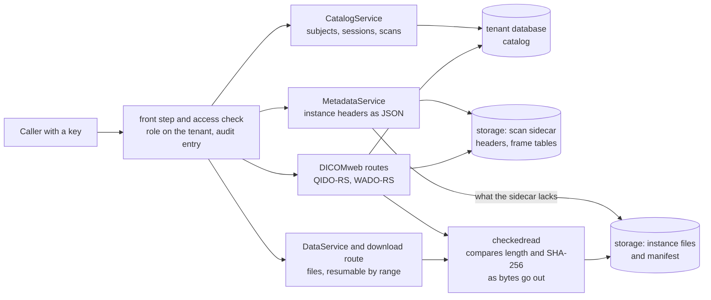

# Reading the archive

[Documentation index](../README.md) · [Architecture](../develop/architecture.md) · [A reception, end to end](receiving.md) · [Receiving through the API](../api/reception-walkthrough.md)

Everything archived is read back through the API, with a key that holds a grant
on the tenant, and every read is audited. The contract is in
`api/proto/nopacs/v1`; the handlers are [internal/api](../../internal/api/doc.go).

| What you want | Where it is served |
|---|---|
| Subjects, sessions and scans, with filters and pages | `CatalogService` (`nopacs catalog`) |
| Each instance's DICOM header as JSON | `MetadataService` (`nopacs scan show --metadata`) |
| The files of a scan, checked as they stream | `DataService` over gRPC and Connect; one instance over HTTP, resumable by range (`nopacs download`) |
| Search, retrieve, metadata, frames and bulk data in the DICOMweb way | QIDO-RS and WADO-RS under `/tenants/<name>/dicom-web` (PS3.18 10.4, 10.6) |
| Store through HTTP | STOW-RS at the same path, into a receiver that lists the key (PS3.18 10.5); see [a reception](receiving.md) |

## How a read goes

After the [path every request takes](../develop/architecture.md#the-path-of-a-request), a
read is answered from the catalog in the tenant's database, from what each scan's
[sidecar](../../internal/receive/sidecar/doc.go) holds on the storage (headers and
[frame tables](../../internal/receive/frames/doc.go)), and from the instance files
themselves, which [checkedread](../../internal/checkedread/doc.go) compares with the
manifest as they go out.

[dicomweb](../../internal/dicomweb/doc.go) holds the protocol without the archive: what
a path names, how a search is read, matching, paging, media types and Warning
headers. [place](../../internal/place/doc.go) opens the storage a scan lives on.

## What a read checks, and its bounds

Each read is checked as its bytes go out and is bounded: what a check cuts, what it
does not check, the 413 limits of a search and the open-read slots are in
[internal/api](../../internal/api/doc.go) (its bounds of the reads) and
[internal/checkedread](../../internal/checkedread/doc.go) (what a checked read guarantees).

## When a read fails

A read that meets a failure before its answer has begun (a scan's metadata file
missing from its storage, an instance's file short or changed) is answered with an
error status and a message, as any request is: `500` with
`{"code":"data_loss","message":"the scan's metadata file is missing from the storage"}`,
for example. A DICOMweb answer (QIDO-RS, WADO-RS, metadata, frames, bulk data) holds
its first 64 KiB before it sends its status, and a download its first piece, so a
failure within them is answered that way.

A failure met after the answer has begun cannot change its status, which is already
sent. The server ends the answer short, and the client can tell:

| Answer | What the client sees |
|---|---|
| QIDO-RS, WADO-RS metadata (a JSON array) | the array has no closing `]`; the body ends without its last chunk |
| WADO-RS instances, frames, bulk data (multipart) | the body has no closing boundary (`--boundary--`) |
| One instance, a bare instance, a bulk window (with `Content-Length`) | fewer bytes than `Content-Length` |

Over HTTP/1.1 the connection is closed before the body's end, which a client reports
as an error (curl exits non-zero, 18 for a body short of its length; Python raises
`http.client.IncompleteRead`); over HTTP/2 the stream is reset. Treat any such
answer as failed and ask again: a download resumes by range. Either way the request
is audited as failed with its reason, and the server's log line of the request names
the failure (`"code":"data_loss"`, for example), never `"ok"`. `DataService/ReadFiles`
ends its stream with an error instead, which the client reads as one.
