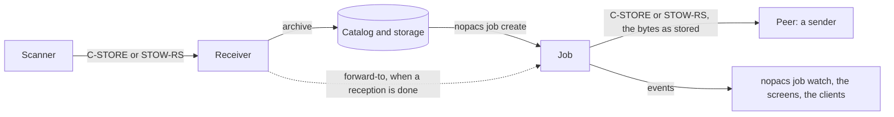
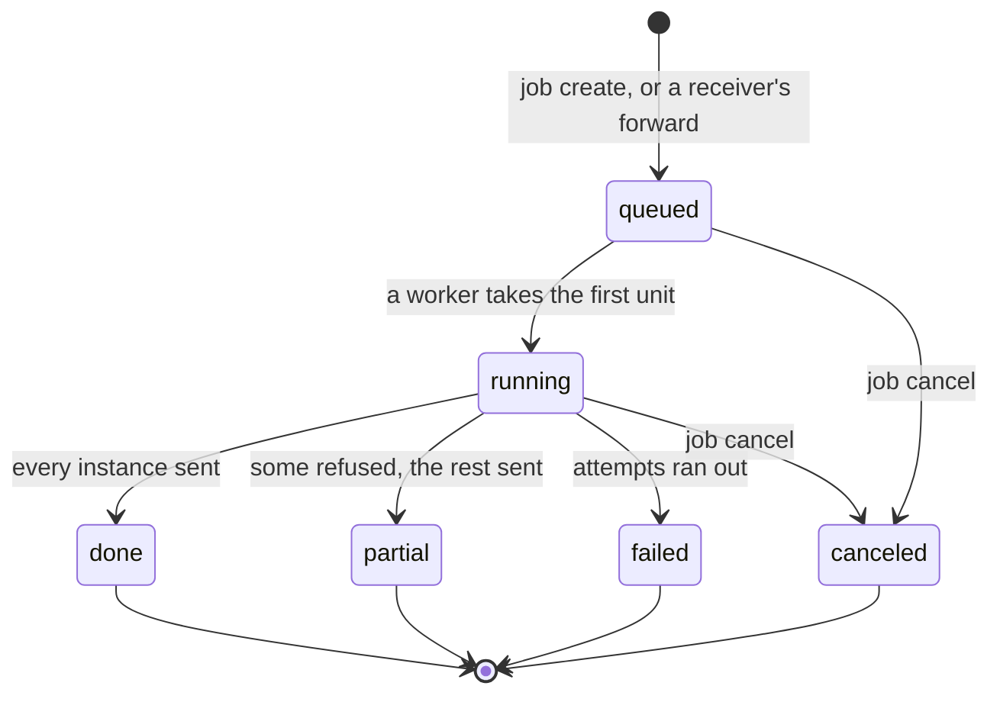

# Sending data on

[Documentation index](../README.md) · [The command line](command-line.md) · [Settings](../operate/settings.md) · [A reception, end to end](receiving.md)

A *sender* is a place archived data may be sent to: a PACS, an Orthanc, another
NoPACs. A *job* is the work of sending one subject, session or scan to a sender.
Nothing is sent by itself: a person makes a job, or a receiver that lists the
sender in its `forward-to` makes one for each reception it completes. The rules
are in [send](../../internal/send/doc.go) (how the work is carried out and made safe
to repeat) and in the contract's comments on
[`sender.proto`](../../api/proto/nopacs/v1/sender.proto) and
[`job.proto`](../../api/proto/nopacs/v1/job.proto).

## What you can do



Two kinds of sender:

- **dimse**: the server opens an association with the peer and sends each
  instance by C-STORE. The peer must admit the server's calling AE title.
- **stow**: the server stores instances into the peer's DICOMweb service
  (STOW-RS), with no authentication or with basic, bearer or a named header. The
  credential is read from a file, standard input or a variable, never from an
  argument; the server seals it and never answers it.

Both send the archived bytes as they are stored. Nothing is decoded or
re-encoded, so a peer that does not take an instance's transfer syntax refuses it
and the job lists it as a failure; it is never sent in another syntax.

## Where a sender may send

Sending moves patient data out of the archive, so where a sender may go is the
installation's to decide, not the tenant's. The setting `sender.destinations`
lists the hosts and address ranges (with their ports) a sender may reach; it is
empty by default, so no sender can be added until the installation's admin fills
it. `sender.allow-plain-http` allows a stow sender's URL to be `http`. Every time
a sender connects the server resolves its host again and connects only to an
address the setting allows. A host name's line admits a private or loopback
address only with `private-address`, and a link-local one only with
`link-local`; the cloud metadata addresses (`169.254.169.254`,
`fd00:ec2::254`) are never allowed. See [Settings](../operate/settings.md).

## What a sender may send

By default a sender sends only instances archived **de-identified**: those whose
catalog row records the profile version that de-identified them, and whose image
no pixel rule accepted while it was at risk of burned-in text. Every other
instance is refused, counted and listed on the job with a fixed reason, and the
job goes on with the rest:

| Reason | What it means |
|---|---|
| `as_received` | The instance was archived as received: its receiver did not de-identify it. |
| `no_profile_provenance` | The catalog names the profile version that did it only in part, so which version did it cannot be told. |
| `pixel_risk_accepted` | Its image was at risk of burned-in text and a pixel rule of its profile accepted it as it is, so what its pixels show was not removed. |

A refused instance is never read, and the reason names a fact of the catalog,
never a value of the file. The rule is judged for each instance as its transfer
would start, never when the job is made, and it is one rule for every job: one a
person makes, a receiver's forward, a retry, and one a restored database still
holds. A job made while the sender was allowed more, and run after that was taken
back, refuses what the sender may no longer send. A replace (`correction
replace`) gives the instance the provenance of its new revision: bytes a later
profile version accepted at risk, or bytes archived as received, are judged as
such from the moment the replace is published.

A sender that must receive more (a clinical PACS that takes identified data, a
site's own archive) is marked by an admin on the installation, who also needs
admin on the tenant to change a sender at all:

```sh
nopacs sender set lab1 pacs --allow-identified
nopacs sender set lab1 pacs --allow-identified=false
```

A tenant's admin alone is refused (exit 3), and so is a masked key, whatever its
grants. The same holds for a change of where a marked sender sends (its host,
port, AE titles, URL, TLS or account, the account being a stow sender's
authentication, user name, header name and credential, since on a DICOMweb peer
with several accounts the account decides where data lands): only an admin on
the installation points
a marked sender elsewhere, and the mark is never cleared to let such a change
through. Each change is written to the tenant's audit log with the detail
`allow_identified` and is an event (`SENDER_ALLOW_IDENTIFIED`) in the tenant's
feed. A mark taken back while a scan is being sent stops at that scan's next
instance once the server reads the change, which `sender set` makes at once; a
mark given starts at the next scan. `sender show` prints `Allow identified: yes`
for a marked sender.

## The steps

1. An installation admin allows the destination:
   `nopacs setting set sender.destinations "pacs.lab.example ports=104"`.
2. A tenant admin adds the sender and tries it. Adding connects to nothing;
   `sender test` does, and says in plain words what it found.

   ```sh
   nopacs sender add lab1 pacs --type dimse --host pacs.lab.example --port 104 \
       --called-aet ORTHANC --calling-aet NOPACS --enabled
   nopacs sender test lab1 pacs
   ```

   For a stow sender, `--credential-file` or `--credential-stdin` gives the
   credential: `printf '%s' "$TOKEN" | nopacs sender add lab1 archive2 --type stow
   --url https://pacs2.lab.example/dicom-web --authentication bearer
   --credential-stdin`.
3. An operator makes a job and follows it to its end.

   ```sh
   nopacs job create lab1 --sender pacs sub-0017/ses-2026-03-02
   nopacs job watch lab1 <job id>
   ```

   `job watch` shows the job, then a line for each change of state and each
   report of progress, and exits 0 only when the job ended done. It reads the
   tenant's event feed from the position the job was read at, so no change is
   missed, and follows again when the server ends a stream, as it does at the
   latest when the stream's deadline (30 seconds) passes. `job create --wait`
   does the same for the job it makes.
4. To send everything a receiver archives, name the sender on the receiver:
   `nopacs receiver set lab1 scanner1 --forward-to pacs`. Each reception that
   reaches done makes a job for exactly the instances it archived. A sender that
   is down holds its jobs; it never holds or fails the reception.

## What a job does and how it ends



A job sends the instances the catalog held when it was made. Its work is one unit
per scan. A unit that fails for a temporary cause is tried again after a wait that
doubles from 10 seconds to an hour. A sender is marked down after three
connections in a row fail; the units that met the first two of those failures
spend an attempt each, so up to two attempts per unit are spent before the
sender is marked down. While it is down or stopped no attempt is used, so a peer
down overnight fails nothing: its units are given back as they are, and one
worker tries the peer again (C-ECHO, or a search for studies for a stow sender)
until it answers. What is sent is at least once: if the server stops midway, at
most one batch per unit is sent again.

A job in which no instance was sent and every one was refused ends `partial`,
not `failed`: `partial` is the end of a job whose every instance was answered
with some refused, and `failed` is kept for a job whose attempts ran out with
instances not answered. `job failures` says why each was refused.

`job failures <tenant> <id>` lists the instances the peer refused, with its
status and a reason (`--warnings` adds those it kept with a warning). A DICOM
status (a C-STORE status, or a stow peer's Failure or Warning Reason) is shown
in hexadecimal, such as `A700`; the HTTP status of a stow request the peer
refused whole is shown in decimal after `HTTP`, such as `HTTP 415`. A stow
answer of 404 (the URL names no DICOMweb service), a redirect, 401, 403, 407 or
a 5xx refuses no instance: it is a failure of the sender, counted toward its
health, so a URL or credential that is mended sends what was held back.
`nopacs job create ... --wait` follows the job it makes, as `job watch` does.
`job retry` makes a new job for what an ended job did not send; `job cancel`
ends one that is queued or running.

## Where to see it

| Where | What it shows |
|---|---|
| `nopacs sender list`, `show` | Each sender with its health: up, not connected to yet, or down with the reason |
| `nopacs job list`, `show` | Jobs with their state and how many instances are sent, refused and remaining (`job get` is the same as `job show`) |
| `nopacs job watch`, `nopacs job create --wait` | One job, live, until it ends |
| `nopacs tenant status` | The tenant's receivers, storages, jobs in progress by state, and senders with their health |
| `nopacs watch` | The tenant's event feed as it happens, optionally only some types of event |
| The interactive program | On a tenant, `n` lists the senders with their health and tests a peer; `w` lists the jobs with a progress bar that follows the event feed, a job's screen opens its failures, and cancel and retry ask for the job's id typed. See [The command line](command-line.md) |
| The API | `SenderService`, `JobService`, and `MonitorService.Watch` for the events; the Python and TypeScript clients each have an example that makes a job and follows it, in `clients/python/examples/follow_job.py` and `clients/typescript/examples/follow-job.ts` |

## What is weak

- A sender's credential is sealed with the installation key. Losing the key file
  loses it, as it loses every other secret.
- Without TLS a dimse sender's associations are plain TCP and every instance
  crosses the network unencrypted; that is fit only for a network the site
  trusts. DIMSE user identity is not offered.
- A peer that keeps both copies of an instance sent twice keeps both: the same
  SOP Instance UID with the same bytes is a repeat to every peer tried, but not
  to every peer there is.
- What a sender may send is judged from what the catalog records, not from the
  file: an instance a profile de-identified is trusted as de-identified as far as
  that profile and the check after it go.
