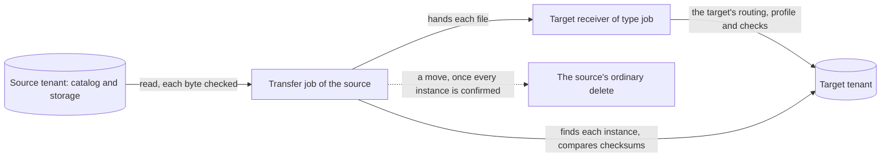

# Copying and moving data between tenants

[Documentation index](../README.md) · [The command line](command-line.md) · [Receiving](receiving.md) · [Sending data on](sending.md) · [Correcting archived data](correcting.md) · [Settings](../operate/settings.md)

A *transfer* copies a subject, or one session of it, from one tenant into another
tenant of the same installation, or moves it: the source is deleted once every
copy is confirmed. The rules are in [transfer](../../internal/transfer/doc.go) and
in the contract's comments on
[`transfer.proto`](../../api/proto/nopacs/v1/transfer.proto).



## The target's door

The bytes go into the target through one of its own receivers, of type `job`. A
`job` receiver never listens on a network; only the server's own jobs hand it
files. Because it is a receiver like any other, the target's routing, its
de-identification profile, its naming rule, its storage quota and its checks apply
to what comes in, and the labels are the target's own. Nothing of the source's
identity travels but the provenance below.

```sh
nopacs receiver add lab2 from-lab1 --type job --storage main --profile research@1 --enabled
```

The target needs one enabled receiver of type `job`, or several when the command
names one with `--via`. A receiver that de-identifies applies its profile to
every file; a receiver with no profile archives the files as they are.

## Making a transfer

```sh
nopacs transfer create lab1 sub-0017/ses-1 --to lab2 --reason "the study belongs to the trial in lab2" --preview
nopacs transfer create lab1 sub-0017/ses-1 --to lab2 --reason "the study belongs to the trial in lab2"
nopacs transfer create lab1 sub-0017 --to lab2 --reason "consent moved to lab2" --move --yes
nopacs transfer show lab1 <id>
nopacs transfer list lab1
nopacs job failures lab1 <id>
```

`--preview` shows what the transfer covers, the receiver it goes through, whether
that receiver de-identifies and how many instances the rule below would fail, and
makes nothing. A copy then starts at once. A move first asks for the source
tenant's name to be typed on a terminal, or takes `--yes`; with no terminal and
no `--yes` it moves nothing and exits 2. One transfer of a subject runs at a time.

A transfer needs **admin on the source and writer on the target**, never a masked
key: where archived data goes is a person's choice. The server checks both when
the job is made and again each time it runs, so a key revoked, expired or demoted
meanwhile ends the job failed instead of going on in its name. Each tenant's
audit log gets its own entry for the request.

## The steps

A transfer is a job of the source tenant (kind `transfer`, shown by `job show`
and `job watch` by its state and counts) with four steps its database saves. A
restart goes on where the last instance was recorded; the target's catalog is
asked before a file is sent again, so a file the target already holds is never
sent twice.

1. **Listing** reads the catalog into the job's items. The instance list stays in
   the source: the target never stores a UID of the source.
2. **Copying** reads each instance's archived bytes through the same checked read
   as every download (its length and SHA-256 against the catalog's, from a replica
   in step when the primary cannot serve it) and hands them to the target's
   receiver, a few at a time. A file whose bytes are not what the catalog records
   is never handed over whole.
3. **Confirming** finds each instance in the target and compares checksums. The
   target gives an instance the UID its receiver's mapping gives: the source's UID
   when the receiver archives as received, the keyed remapping of it when it
   de-identifies. Its *received checksum* is the SHA-256 of the bytes as they were
   handed in when the receiver archives as received, and the keyed form of it
   (HMAC-SHA-256 under the target's UID key) when it de-identifies; the source's
   side of the comparison is the SHA-256 of its archived bytes. An instance that
   differs is failed and never confirmed. One the target does not hold within an
   hour is failed as unaccounted: it may be in the target's quarantine.
4. **Deleting**, for a move only, runs once every instance is confirmed. Before the
   delete the job reads the target again and finds every confirmed instance there
   with the checksum the confirmation found; reads the source again and finds exactly
   the instances that were copied; and compares the delete's own preview with them,
   the same instances and scans. Then comes the source's ordinary preview and
   [delete](correcting.md#delete), with the reason `moved to <target> (transfer
   <id>)`. So a hold, a retention rule's keep-at-least, the grace period, undo and
   purge apply as to any delete. A hold or a rule that stops it, or any of those
   checks failing, ends the job partial, and the copy stays in the target. A stop
   between the delete and its record is found on the next pass by the job's id in the
   delete's reason, and the job ends done; a source deleted by something else ends
   the job partial.

The job ends **done** when every instance is confirmed (and a move's source is
deleted), **partial** when some failed or the source was kept (the reason says
which), **failed** when the job could not run (the target is gone, has no enabled
receiver of type `job`, or the key may no longer run it), and **canceled** after
`job cancel`; what was copied before a cancel stays in the target.

## What may leave

A transfer hands archived bytes to another tenant, so it obeys the rule every
path that does so obeys ([sending](sending.md#where-a-sender-may-send)),
instance by instance as it is handed over: an instance archived as received, or
whose image a pixel rule accepted at risk of burned-in text, is copied only into a
receiver that de-identifies. The target's receiver checks it again for each file it
takes, so a receiver changed to archive as received while the job copies takes no
more of them: they are failed, and nothing lands. Into a receiver that does not, such an instance is
failed (`as_received` or `pixel_risk_accepted`) while the job goes on with the rest.
The target's own profile and pixel rules then judge what a de-identifying
receiver is given, as for any file it receives.

Other failures reuse the job's codes: `damaged_in_storage` (the source's bytes
are not what the catalog records), `not_online`, `deleted_in_archive` (the
instance changed or went after the job listed it), `peer_refused` (the target's
receiver did not take the file, or its catalog holds another checksum) and
`peer_unaccounted` (the target does not hold it).

## Provenance

For each instance it confirms, the job records in the target, keyed by the
target's own SOP Instance UID, the source tenant's id, the labels the instance had
in the source, its revision there and the job's id. It holds no UID of the source
and no original identifier: the labels are left out for an instance the source
archived as received, since a label made from a patient's identifier is one. The
table is `transfer_provenance` in the target's database. An instance the target
already held keeps the provenance it had first: a later transfer that finds it there
does not replace it.

## What is weak

- A source that is very large is held in memory by a move's check that the source
  is unchanged (one entry per instance); a transfer of a million instances needs
  roughly 150 MB for it.
- A crash between the target taking a file and the job recording it leaves the file
  landed and recorded by the target's catalog, which the job finds on its next pass
  and does not send again; only a file still in the target's incoming area at that
  moment can arrive twice, and the target's catalog keeps one of two files of one UID
  and checksum.
- The confirmation compares what the target's receiver gives, not a routing rule that
  would de-identify with another profile than the receiver's: a route that does is
  not followed in the comparison, and its instances are failed as unaccounted.
- The provenance rows stay when an instance is later deleted or relabeled in the
  target.
- A moved or fenced tenant, a target whose reception pipeline does not run, a target
  that is busy or over its quota, make the job wait. It waits at most `transfer.wait`
  (24 hours by default, [settings](../operate/settings.md)), counted from the first
  pass that waited and forgotten when the server restarts; past it the job ends
  failed and its subject is free for another.
